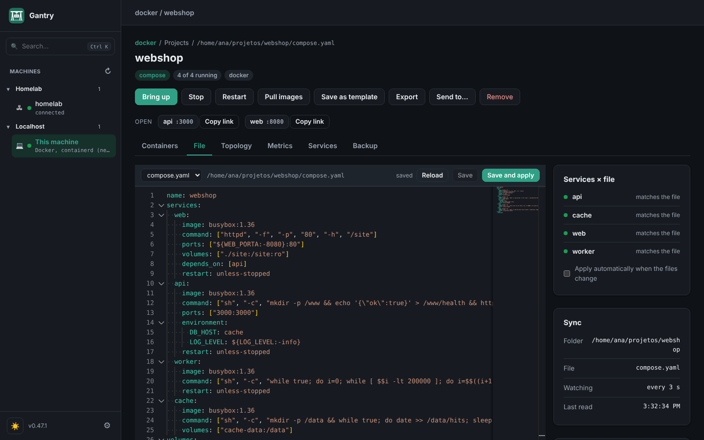

<p align="center">
  
</p>

<h1 align="center">Gantry</h1>

<p align="center">
  <b>One desktop app for your containers, compose projects, VMs, network labs and Kubernetes clusters, on this computer and on your servers over SSH.</b>
</p>

<p align="center">
  <b>English</b> · <a href="README.pt-BR.md">Português</a> ·
  <a href="https://gonservice.github.io/gantry/">Website</a> ·
  <a href="docs/guide/README.md">Guide</a> ·
  <a href="docs/reference.md">Reference</a>
</p>

<p align="center">
  <a href="LICENSE"></a>
  
  
</p>


Gantry talks straight to the Docker and Podman APIs. There is nothing to host and no agent to install on your servers: the state comes from the engine itself, so whatever you start from the terminal (`docker run`, `docker compose up`, `podman compose up`) shows up in the app right away. Projects are your own `compose.yaml` files; Gantry adds two optional extensions (`x-gantry` and `x-vms`) and no new format.

## What it does

| | |
|---|---|
| **Machines** | This computer and any server you reach over SSH, in one sidebar with folders. Docker, Podman and containerd (also k3s) on the same machine appear once. Hardware and CPU, memory and disk usage, read by a short script: no agent. |
| **Projects** | Every compose project, grouped from the labels Compose writes. Up, stop, restart, pull, rebuild, remove. Edit the compose file and `.env` in the app (or in your editor: the app follows), see which services differ from the file and apply the change. |
| **Containers** | Logs (with filter and time range), shell, files (browse, download, upload), live CPU and memory, events, edit and recreate, duplicate, commit to an image. Images, volumes and networks with what uses each one. |
| **Create a project** | A three-step wizard: from 30+ templates (Postgres, Redis, Kafka, Grafana, Keycloak, Ollama + Open WebUI…), from a pasted `docker-compose`, or from `docker run` commands converted to compose. Port variables already taken on the target machine get the next free port before anything starts. |
| **Virtual machines** | QEMU VMs declared in the same compose (`x-vms`): Debian, Ubuntu, Rocky, k3s, an ISO or your own qcow2. Console, screen (VNC), shell, snapshots, clone, resize disk. HVF on macOS, KVM on Linux. |
| **Network labs** | Cisco IOL, Dynamips (7200, 3725, 2691) and VPCS next to containers (FRR, any Linux) in one compose, wired by cables. Draw the topology, capture any cable live (save `.pcap` for Wireshark), save and restore lab states, import PNETLab and EVE-NG `.unl` labs as they are. |
| **Kubernetes** | Clusters from your kubeconfig or created by a project (k3s in VMs). Workloads, pods, logs (including the previous run), shell, port forward, events, Helm releases with rollback, CRDs, YAML apply, drain. Read-only mode per cluster. |
| **Day-to-day** | Backups of volumes, databases and files (manual or scheduled), secrets in the system keychain instead of `.env`, shared services (one Postgres used by several projects), image update checks, metrics charts, alerts from Prometheus, Grafana and Loki links. |
| **AI assistants** | A built-in MCP server: an assistant can read projects, containers, logs and clusters through the open Gantry, and only change things if you allow it. |

## Screenshots

| | |
|---|---|
|  |  |
| **A machine**: hardware, usage and its projects | **A network lab**: routers, LANs and cables, drawn from the compose |
|  |  |
| **Edit the compose** and see what differs from what runs | **Metrics** per container and VM |

More in the [step-by-step guide](docs/guide/README.md).

## Download

One command, for your user, without sudo or admin (it checks the files against the release checksums; run it again to update):

```bash
curl -fsSL https://gonservice.github.io/gantry/install.sh | sh      # Linux and macOS
```
```powershell
irm https://gonservice.github.io/gantry/install.ps1 | iex           # Windows (PowerShell)
```

On a Linux without a desktop (or with `| sh -s -- --server`), it installs the server version. Or pick the file:

| System | Download |
|---|---|
| macOS, with Homebrew | `brew install --cask gonservice/tap/gantry` |
| macOS (Apple Silicon and Intel) | `Gantry-X.Y.Z-macos.zip` |
| Linux desktop app (x86_64) | `Gantry-X.Y.Z-linux-amd64.tar.gz`, then `./instalar.sh` |
| Windows (experimental, through WSL2) | `Gantry-X.Y.Z-windows.zip` |
| Headless Linux server (the UI opens in a browser) | `gantry-servidor-X.Y.Z-linux-amd64.tar.gz` or `-arm64` |

The files are on the [releases page](https://github.com/GonService/gantry/releases). The apps are not signed yet: on macOS, the Homebrew cask takes care of it; with the zip, open it the first time with right-click › Open. On Linux, the desktop app needs WebKitGTK 4.1 (`instalar.sh` tells you the command if it is missing).

## Quick start

1. Open Gantry. The first screen shows what it found on this computer (Docker, Podman, containerd, QEMU) and offers the servers in your `~/.ssh/config` and the clusters in your `~/.kube/config`, one click each.
2. Your running compose projects are already listed under **This machine**. Open one to see its containers, logs and files.
3. **Create project** › **Containers** › pick a template (try **Postgres + Adminer**) › **Generate project**. The project folder, the `compose.yaml` and the `.env` are created and it goes up.
4. Add a server: the gear › **Machines** › **Add**, with an address like `ssh://homelab` or `ssh://ana@192.0.2.10`. It connects only when you open it.

The [guide](docs/guide/README.md) walks through these and other real cases: a network lab with routers, importing a PNETLab lab, VMs, backups, Kubernetes.

## How it differs

- **Your files stay the source of truth.** A project is a plain `compose.yaml` that `docker compose` still runs without Gantry; the app keeps no copy of it in a format of its own.
- **Nothing to deploy.** No web server to host, no agent required on servers: SSH and the engine socket are enough. An optional small agent adds 24 h of metric history and a direct TLS connection.
- **Containers, VMs and network devices in one place.** One compose can hold Docker and Podman services, QEMU VMs and Cisco routers wired to Linux containers. Labs that would need a dedicated emulation server run on your laptop or any Linux box.
- **Faithful imports.** A PNETLab or EVE-NG lab comes in with the same devices, cards, cables and saved configs, including the mistakes a teacher put there on purpose. What had to change is written down in `IMPORTACAO.md`.
- **One binary, local first.** The UI is served on `127.0.0.1` with a per-run token; remote access goes through SSH tunnels.

## Documentation

| | |
|---|---|
| [Step-by-step guide](docs/guide/README.md) | Features with screenshots and practical cases |
| [Reference](docs/reference.md) | Everything the app does, compose extensions, remote hosts, agent, configuration, security model |
| [Network equipment](docs/network-labs.md) | IOL, Dynamips and VPCS: cards, NPE, memory, images, imports |
| [Security policy](SECURITY.md) | How to report a vulnerability |
| [Examples](examples/README.md) | Ready projects: VMs, mixed labs, observability, Cisco labs |

## Build from source

Requires Go, Node and [Wails](https://wails.io) v2. On macOS, the Xcode command line tools; on Linux, the WebKitGTK 4.1 and GTK 3 development packages (Fedora: `sudo dnf install webkit2gtk4.1-devel gtk3-devel`; Debian/Ubuntu: `sudo apt install libwebkit2gtk-4.1-dev libgtk-3-dev`).

```bash
make deps     # installs wails
make run      # builds and opens the app (macOS or Linux)
make web      # the browser version, no window: ./dist/gantry -web
make test     # unit and API tests, no engine needed
```

`make linux` builds the Linux app and its package; `make release` builds every distribution. Details in the [reference](docs/reference.md#running-on-macos).

## License

Copyright (C) 2026 GonService.

Gantry is free software under the [GNU Affero General Public License v3.0](LICENSE). You can use, study, change and share it; modified versions, including ones offered to others over a network (Gantry's browser mode), must also be shared with their source code under the same license.

Bundled third-party components keep their own licenses: VPCS (BSD, `internal/vpcsbin/bin/COPYING`) and xterm.js (MIT, `web/vendor/xterm-LICENSE`). Cisco images (IOL, Dynamips IOS) are not part of this project and are not distributed here.

Found a security issue? Please do not open a public issue: see [SECURITY.md](SECURITY.md).
