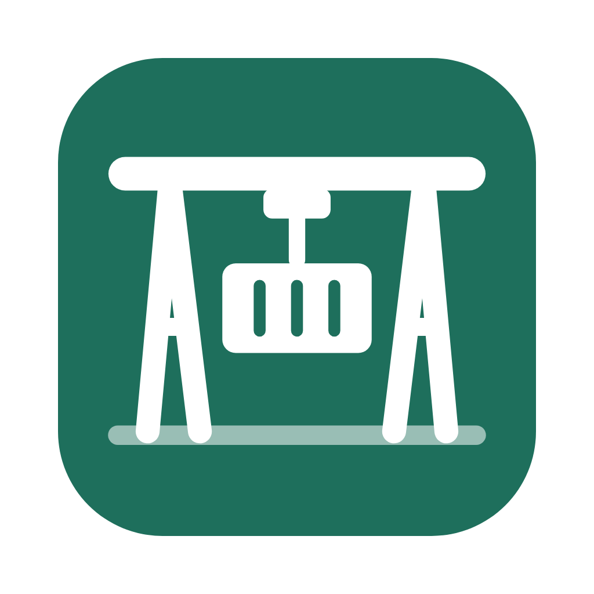
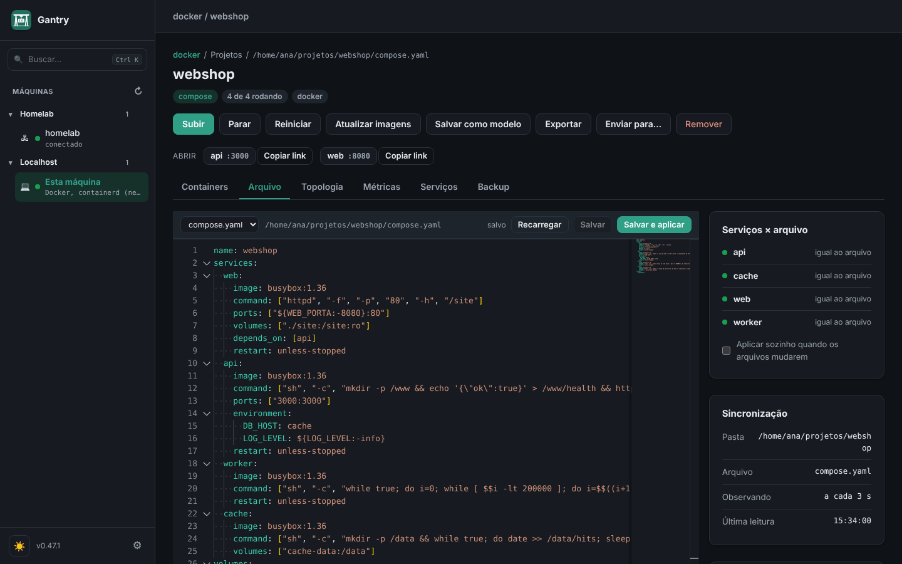

<p align="center">
  
</p>

<h1 align="center">Gantry</h1>

<p align="center">
  <b>Um app desktop para os seus containers, projetos compose, VMs, labs de rede e clusters Kubernetes, neste computador e nos seus servidores via SSH.</b>
</p>

<p align="center">
  <a href="README.md">English</a> · <b>Português</b> ·
  <a href="https://gonservice.github.io/gantry/?lang=pt">Site</a> ·
  <a href="docs/guia/README.md">Guia</a> ·
  <a href="docs/referencia.md">Referência</a>
</p>

<p align="center">
  <a href="LICENSE"></a>
  
  
</p>


O Gantry conversa direto com a API do Docker e do Podman. Não há nada para hospedar nem agente obrigatório nos servidores: o estado vem do próprio engine, então o que você sobe pelo terminal (`docker run`, `docker compose up`, `podman compose up`) aparece no app na hora. Os projetos são os seus arquivos `compose.yaml`; o Gantry acrescenta duas extensões opcionais (`x-gantry` e `x-vms`) e nenhum formato novo.

## O que faz

| | |
|---|---|
| **Máquinas** | Este computador e qualquer servidor que você alcança por SSH, numa barra lateral com pastas. Docker, Podman e containerd (e o k3s) da mesma máquina aparecem uma vez só. Hardware e uso de CPU, memória e disco, lidos por um script curto, sem agente. |
| **Projetos** | Todo projeto compose, agrupado pelas labels que o Compose grava. Subir, parar, reiniciar, atualizar imagens, reconstruir, remover. Edite o compose e o `.env` no app (ou no seu editor: o app acompanha), veja quais serviços estão diferentes do arquivo e aplique a mudança. |
| **Containers** | Logs (com filtro e período), shell, arquivos (navegar, baixar, enviar), CPU e memória ao vivo, eventos, editar e recriar, duplicar, gravar como imagem. Imagens, volumes e redes, com o que usa cada um. |
| **Criar projeto** | Um assistente em três passos: de mais de 30 modelos (Postgres, Redis, Kafka, Grafana, Keycloak, Ollama + Open WebUI…), de um `docker-compose` colado ou de comandos `docker run` convertidos em compose. As variáveis de porta já em uso na máquina de destino ganham a próxima porta livre antes de qualquer coisa subir. |
| **Máquinas virtuais** | VMs QEMU declaradas no mesmo compose (`x-vms`): Debian, Ubuntu, Rocky, k3s, uma ISO ou um qcow2 seu. Console, tela (VNC), shell, snapshots, clonar, aumentar o disco. HVF no macOS, KVM no Linux. |
| **Labs de rede** | Cisco IOL, Dynamips (7200, 3725, 2691) e VPCS junto de containers (FRR, qualquer Linux) num compose só, ligados por cabos. Desenhe a topologia, capture qualquer cabo ao vivo (e salve o `.pcap` para o Wireshark), guarde e volte estados do lab, importe labs `.unl` do PNETLab e do EVE-NG como eles são. |
| **Kubernetes** | Clusters do seu kubeconfig ou criados por um projeto (k3s em VMs). Workloads, pods, logs (inclusive da execução anterior), shell, encaminhar porta, eventos, releases do Helm com rollback, CRDs, aplicar YAML, drain. Modo só leitura por cluster. |
| **Dia a dia** | Backup de volumes, bancos e arquivos (na hora ou agendado), segredos no chaveiro do sistema em vez do `.env`, serviços compartilhados (um Postgres usado por vários projetos), aviso de versões novas das imagens, gráficos de métricas, alertas do Prometheus, links do Grafana e do Loki. |
| **Assistentes de IA** | Um servidor MCP embutido: um assistente consulta projetos, containers, logs e clusters pelo Gantry aberto, e só muda algo se você permitir. |

## Telas

| | |
|---|---|
|  |  |
| **Uma máquina**: hardware, uso e os projetos dela | **Um lab de rede**: roteadores, LANs e cabos, desenhados a partir do compose |
|  |  |
| **Edite o compose** e veja o que está diferente do que roda | **Métricas** por container e VM |

Mais no [guia passo a passo](docs/guia/README.md).

## Baixar

| Sistema | Baixar |
|---|---|
| macOS, pelo Homebrew | `brew install --cask gonservice/tap/gantry` |
| macOS (Apple Silicon e Intel) | `Gantry-X.Y.Z-macos.zip` |
| Linux, app desktop (x86_64) | `Gantry-X.Y.Z-linux-amd64.tar.gz`, depois `./instalar.sh` |
| Windows (experimental, pelo WSL2) | `Gantry-X.Y.Z-windows.zip` |
| Servidor Linux sem tela (a interface abre no navegador) | `gantry-servidor-X.Y.Z-linux-amd64.tar.gz` ou `-arm64` |

Os arquivos estão na [página de versões](https://github.com/GonService/gantry/releases). Os apps ainda não são assinados: no macOS, a receita do Homebrew resolve isso; com o zip, abra a primeira vez com botão direito › Abrir. No Linux, o app desktop precisa do WebKitGTK 4.1 (o `instalar.sh` diz o comando se faltar).

## Primeiros passos

1. Abra o Gantry. A primeira tela mostra o que ele achou neste computador (Docker, Podman, containerd, QEMU) e oferece os servidores do seu `~/.ssh/config` e os clusters do seu `~/.kube/config`, um clique cada.
2. Os projetos compose que já rodam aparecem em **Esta máquina**. Abra um para ver os containers, os logs e os arquivos.
3. **Criar projeto** › **Containers** › escolha um modelo (experimente **Postgres + Adminer**) › **Gerar projeto**. A pasta do projeto, o `compose.yaml` e o `.env` são criados e ele sobe.
4. Adicione um servidor: engrenagem › **Máquinas** › **Adicionar**, com um endereço como `ssh://homelab` ou `ssh://ana@192.0.2.10`. Ele só conecta quando você abre.

O [guia](docs/guia/README.md) mostra estes e outros casos reais: um lab de rede com roteadores, importar um lab do PNETLab, VMs, backup, Kubernetes.

## O que muda em relação a outras ferramentas

- **Os seus arquivos continuam sendo a fonte.** Um projeto é um `compose.yaml` comum, que o `docker compose` roda sem o Gantry; o app não guarda uma cópia dele num formato próprio.
- **Nada para instalar no servidor.** Sem servidor web para hospedar e sem agente obrigatório: SSH e o socket do engine bastam. Um agente pequeno e opcional acrescenta 24 h de histórico de métricas e uma conexão direta com TLS.
- **Containers, VMs e equipamentos de rede num lugar só.** Um compose pode ter serviços no Docker e no Podman, VMs QEMU e roteadores Cisco ligados a containers Linux. Labs que pediriam um servidor de emulação dedicado rodam no seu notebook ou em qualquer Linux.
- **Importação fiel.** Um lab do PNETLab ou do EVE-NG entra com os mesmos equipamentos, placas, cabos e configurações salvas, inclusive os erros que o professor pôs de propósito. O que precisou mudar fica escrito no `IMPORTACAO.md`.
- **Um binário, local primeiro.** A interface roda em `127.0.0.1` com um token por execução; o acesso remoto passa por túneis SSH.

## Documentação

| | |
|---|---|
| [Guia passo a passo](docs/guia/README.md) | As funções com telas e casos práticos |
| [Referência](docs/referencia.md) | Tudo o que o app faz, extensões do compose, hosts remotos, agente, configuração, segurança |
| [Equipamentos de rede](docs/equipamentos-de-rede.md) | IOL, Dynamips e VPCS: placas, NPE, memória, imagens, importação |
| [Política de segurança](SECURITY.md) | Como reportar uma falha |
| [Exemplos](examples/README.md) | Projetos prontos: VMs, labs mistos, observabilidade, labs Cisco |

## Compilar

Precisa do Go, do Node e do [Wails](https://wails.io) v2. No macOS, as ferramentas de linha de comando do Xcode; no Linux, os pacotes de desenvolvimento do WebKitGTK 4.1 e do GTK 3 (Fedora: `sudo dnf install webkit2gtk4.1-devel gtk3-devel`; Debian/Ubuntu: `sudo apt install libwebkit2gtk-4.1-dev libgtk-3-dev`).

```bash
make deps     # instala o wails
make run      # compila e abre o app (macOS ou Linux)
make web      # a versão de navegador, sem janela: ./dist/gantry -web
make test     # testes de unidade e da API, sem precisar de engine
```

`make linux` gera o app do Linux e o pacote; `make release` gera todas as distribuições. Detalhes na [referência](docs/referencia.md#rodando-no-macos).

## Licença

Copyright (C) 2026 GonService.

O Gantry é software livre sob a [GNU Affero General Public License v3.0](LICENSE) (AGPL-3.0): você pode usar, estudar, modificar e distribuir, desde que versões modificadas, inclusive as oferecidas a outras pessoas pela rede (o modo navegador do Gantry), também sejam distribuídas com o código-fonte, sob a mesma licença.

Componentes de terceiros embutidos mantêm as licenças deles: o VPCS (BSD, `internal/vpcsbin/bin/COPYING`) e o xterm.js (MIT, `web/vendor/xterm-LICENSE`). As imagens dos equipamentos Cisco (IOL, IOS do Dynamips) não fazem parte do projeto e não são distribuídas aqui.

Achou uma falha de segurança? Não abra uma issue pública: veja [SECURITY.md](SECURITY.md).
