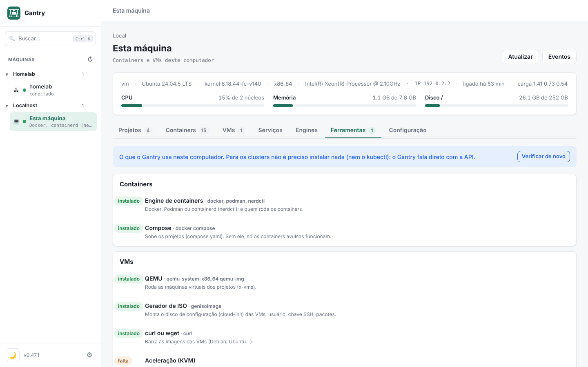
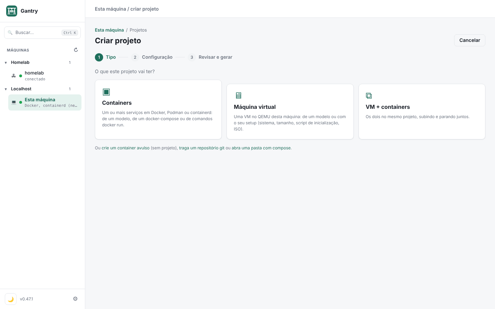
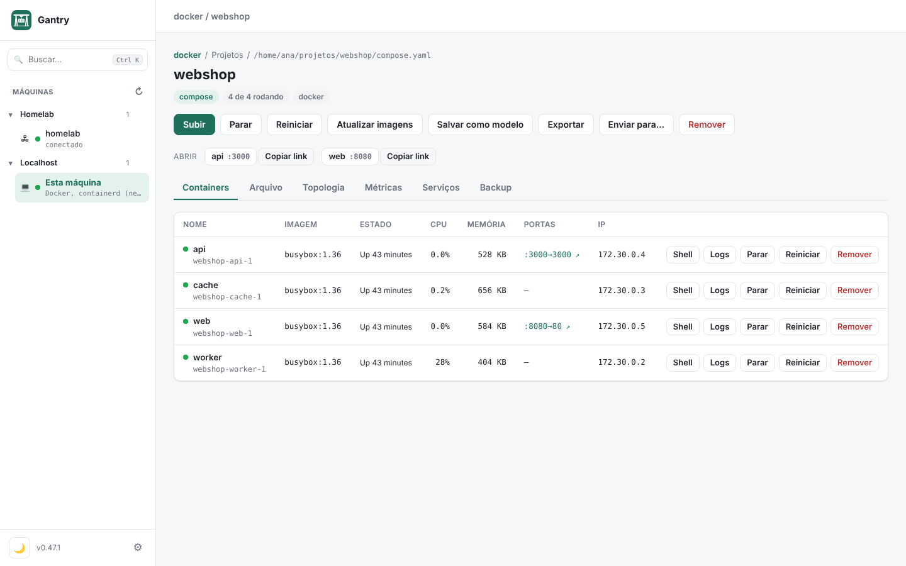
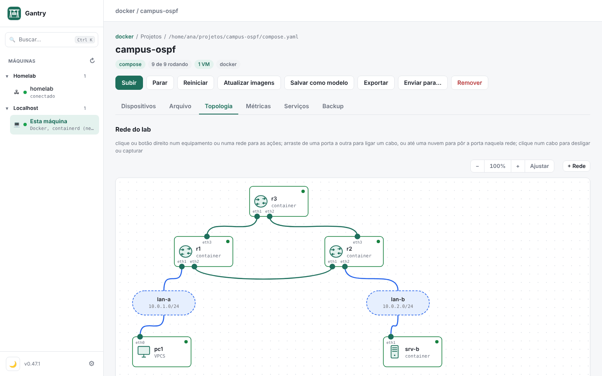
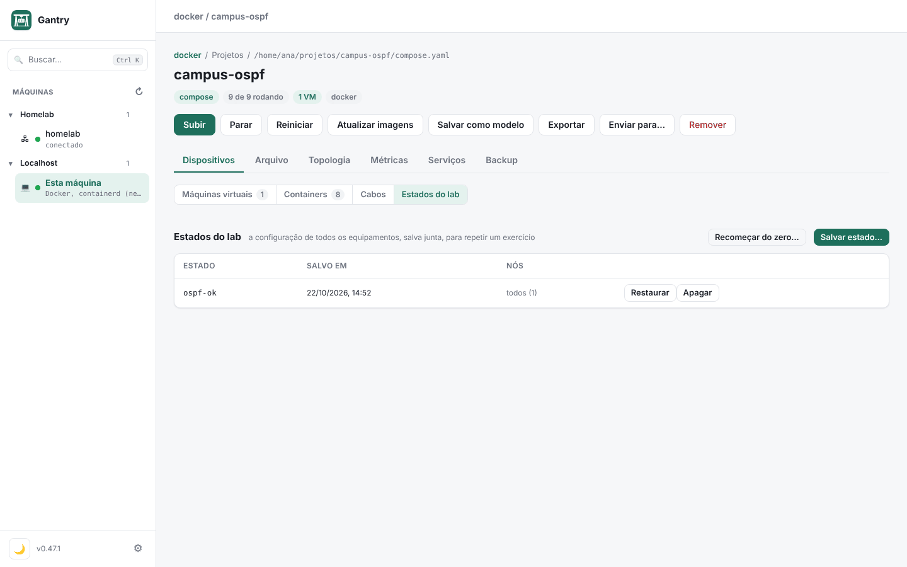
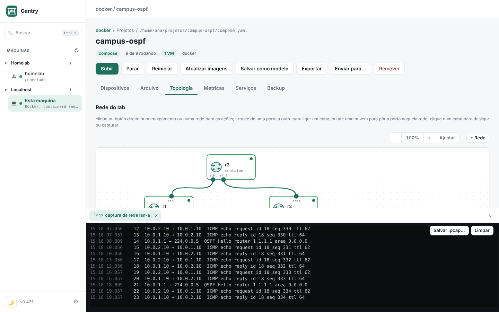

# Do zero a um lab completo

[English](from-scratch.md) · **Português** · [Guia](guia/README.md) · [Referência](referencia.md) · [Voltar ao início](../README.pt-BR.md)

Este tutorial mostra, passo a passo, como montar no Gantry tudo o que um lab pode ter: um **container**, uma **máquina virtual** e um **roteador**. No fim, junta os três num lab só, com um computador de lab e cabos entre eles. Começa no terminal, criando as pastas no seu computador, e termina com tudo configurado e testado dentro do Gantry.

Os casos se apoiam um no outro, mas cada um funciona sozinho. Quem só quer um container pode parar no caso 1.

**Conteúdo**

0. [Antes de começar: as palavras do Gantry](#0-antes-de-começar-as-palavras-do-gantry)
1. [Preparar o computador](#1-preparar-o-computador)
2. [Criar as pastas no computador](#2-criar-as-pastas-no-computador)
3. [Duas formas de criar: o assistente ou o arquivo](#3-duas-formas-de-criar-o-assistente-ou-o-arquivo)
4. [Caso 1: um container](#4-caso-1-um-container)
5. [Caso 2: uma máquina virtual](#5-caso-2-uma-máquina-virtual)
6. [Caso 3: roteadores](#6-caso-3-roteadores)
7. [Caso 4: tudo junto num lab](#7-caso-4-tudo-junto-num-lab)
8. [Mudar o lab depois](#8-mudar-o-lab-depois)
9. [Organizar, guardar e levar para outro lugar](#9-organizar-guardar-e-levar-para-outro-lugar)
10. [Quando algo não funciona](#10-quando-algo-não-funciona)
11. [Resumo: os arquivos de cada caso](#11-resumo-os-arquivos-de-cada-caso)

## 0. Antes de começar: as palavras do Gantry

No dia a dia, "máquina" pode ser uma VM, um roteador ou um container. No Gantry, cada coisa tem um nome, e saber qual é qual ajuda a achar os botões:

| No Gantry | O que é | Exemplo |
|---|---|---|
| **Máquina** | Um computador que roda as coisas: este computador ou um servidor por SSH. Fica na barra lateral. | Este Mac, o servidor `homelab` |
| **Projeto** (ou **lab**) | Uma pasta com um `compose.yaml`. Tudo o que você cria mora num projeto. | `~/gantry/meu-lab` |
| **Container** | Um serviço do compose (`services:`). | Nginx, Postgres |
| **VM** | Uma máquina virtual no QEMU, declarada em `x-vms:`. | Debian com Nginx |
| **Equipamento de rede** | Um roteador, switch ou computador de lab, também em `x-vms:`. Não é VM: é um programa leve na máquina. | Cisco 7200 (Dynamips), IOL, VPCS |
| **Cabo** | A ligação entre duas portas. Duas pontas com o mesmo nome estão ligadas. | `r1-r2` |
| **Rede do lab** | Um switch onde várias portas se ligam, declarado em `x-redes:`. | `lan-a` |

O Gantry não tem um formato próprio escondido: o projeto é o seu `compose.yaml`, mais os arquivos que você puser na pasta. Dá para abrir, ler e mudar tudo num editor de texto.

## 1. Preparar o computador

### 1.1 Instalar o Gantry

Veja [Baixar](../README.pt-BR.md#baixar). No Mac, o mais simples é o Homebrew:

```sh
brew install --cask gonservice/tap/gantry
```

No Linux:

```sh
curl -fsSL https://gonservice.github.io/gantry/install.sh | sh
```

Abra o Gantry. A barra lateral mostra **Esta máquina**.

### 1.2 Um engine de containers

Containers precisam de um engine (Docker, Podman ou containerd).

**No Mac**, o jeito mais leve é a **Container VM** do próprio Gantry: uma VM Linux pequena só para os containers, que devolve ao Mac a memória que não usa.

1. Clique em **Esta máquina** › aba **Engines** › **Criar a Container VM**.
2. **Configurar:** deixe o nome `gantry-vm`, marque os engines que quer (Docker, Podman, os dois) e ajuste CPUs, memória e disco, se quiser. Dá para mudar depois.
3. **Revisar o script:** é o script que vai preparar a VM. Leia, se quiser, e aprove.
4. **Criar e ligar:** o Gantry baixa o Debian, prepara a VM e liga. Leva alguns minutos na primeira vez.

Quando termina, os engines da VM aparecem como engines deste Mac, e o `docker` e o `podman` do terminal já falam com ela.

Se você já usa o Docker Desktop, o OrbStack ou a `podman machine`, pode pular este passo: o Gantry acha esses engines sozinho.

**No Linux**, instale o engine pelo sistema:

```sh
# Fedora
sudo dnf install podman podman-compose
# Debian ou Ubuntu
sudo apt install podman podman-compose
```

### 1.3 O que as VMs e os roteadores usam

| Para | Mac | Fedora | Debian/Ubuntu |
|---|---|---|---|
| VMs (caso 2) | `brew install qemu` | `sudo dnf install qemu-kvm qemu-img genisoimage` | `sudo apt install qemu-system qemu-utils genisoimage` |
| Roteadores (caso 3) | `brew install dynamips` | `sudo dnf install dynamips python3` | `sudo apt install dynamips python3` |

Nem precisa decorar: a aba **Ferramentas** da máquina lista o que falta e mostra o comando certo para o seu sistema. No Mac, o que vem do Homebrew instala com um botão.



> **Onde roda cada coisa.** Containers, VMs e roteadores Dynamips rodam no Mac e no Linux. Os equipamentos **IOL** e **VPCS** (o computador de lab do caso 4) precisam de um Linux x86_64: este computador, se for Linux, ou um servidor por SSH (veja [Adicionar um servidor via SSH](guia/README.md#3-adicionar-um-servidor-via-ssh)). Os passos são os mesmos nos dois casos; só muda a máquina que você escolhe.

## 2. Criar as pastas no computador

Duas pastas bastam:

- `~/gantry`: onde ficam os projetos, uma pasta por projeto. É a pasta que o Gantry já sugere ao criar um projeto.
- `~/gantry/imagens`: onde ficam as imagens que o Gantry não baixa sozinho (as dos roteadores Cisco, por exemplo). É uma das pastas de imagens que o Gantry já procura.

No terminal (o mesmo comando no Mac e no Linux):

```sh
mkdir -p ~/gantry/imagens
```

Para cada projeto, uma pasta dentro de `~/gantry`. Os casos deste tutorial usam estas:

```sh
mkdir -p ~/gantry/meu-site                    # caso 1: container
mkdir -p ~/gantry/minha-vm                    # caso 2: VM
mkdir -p ~/gantry/meu-lab/equipamentos        # casos 3 e 4: roteadores e o lab completo
```

Prefere sem terminal? No Finder (ou no gerenciador de arquivos do Linux), vá à sua pasta pessoal e crie a pasta `gantry` e, dentro dela, as outras. O resultado é o mesmo.

Um projeto tem esta cara:

```
~/gantry/meu-lab/
├── compose.yaml          o projeto: containers, VMs, equipamentos, cabos
├── .env                  variáveis (portas, senhas), opcional
└── equipamentos/         a configuração inicial de cada equipamento de rede
    ├── R1.cfg
    └── PC1.vpc
```

O Gantry também cria uma pasta `.gantry/` dentro do projeto, com arquivos que ele gera ao subir. Não precisa mexer nela. Os discos das VMs e a memória dos roteadores (NVRAM) ficam fora do projeto, em `~/.local/state/gantry/`.

**Num servidor por SSH**, as pastas são criadas no servidor, não no seu computador. Crie pelo terminal dele (`ssh homelab mkdir -p ~/gantry/imagens`) ou deixe para o Gantry: ao escolher a pasta de um projeto num servidor, o seletor do Gantry lista as pastas de lá e cria pastas novas.

## 3. Duas formas de criar: o assistente ou o arquivo

Todo projeto termina num `compose.yaml`. Você pode chegar nele de dois jeitos, e misturar os dois quando quiser:

| | O assistente (**Criar projeto**) | O arquivo (**Abrir pasta com compose**) |
|---|---|---|
| Como | O Gantry pergunta, mostra o YAML e grava a pasta | Você escreve o `compose.yaml` no seu editor e abre a pasta no Gantry |
| Bom para | Começar rápido, usar um modelo pronto, converter um `docker run` | Controlar cada linha, copiar de um lab que já existe, versionar no git |
| Onde fica | Projetos › **＋ Criar projeto** | Projetos › **Outras formas** › **Abrir pasta com compose** |

Os casos abaixo mostram os dois caminhos. Depois de criado, o projeto é o mesmo, venha de onde vier.

## 4. Caso 1: um container

Um site estático no Nginx, aberto no navegador.

### Pelo assistente

1. Na barra lateral, clique em **Esta máquina** › aba **Projetos** › **＋ Criar projeto**.
2. **Tipo:** escolha **Containers**.
3. **Configuração:** escolha o engine (Docker ou Podman) e, em **Modelo**, o **Nginx**.
4. **Revisar e gerar:**
   - **Nome:** `meu-site`.
   - **Pasta no host:** o Gantry sugere `~/gantry/meu-site`. Use **Escolher…** para apontar outra pasta.
   - **Máquina de destino:** esta máquina (ou um servidor).
   - Se uma porta do modelo já estiver em uso na máquina, o campo dela já vem com a próxima livre, e o motivo aparece embaixo.
   - Deixe marcado **Subir depois de gerar** e clique em **Gerar projeto**.



O Gantry grava o `compose.yaml` e o `.env` na pasta, sobe o container e abre a página do projeto.

### Pelo arquivo

1. Crie `~/gantry/meu-site/compose.yaml`:

   ```yaml
   name: meu-site
   services:
     web:
       image: nginx:1.27-alpine
       ports: ["${WEB_PORTA:-8080}:80"]
       volumes: ["./site:/usr/share/nginx/html:ro"]
   ```

2. Crie a página, em `~/gantry/meu-site/site/index.html`:

   ```html
   <h1>Olá do Gantry</h1>
   ```

3. No Gantry: **Esta máquina** › **Projetos** › **Outras formas** › **Abrir pasta com compose**. Escolha `~/gantry/meu-site` e clique em **Subir**.

### Usar e conferir

- A faixa **Abrir**, no topo do projeto, tem o link do site (`http://localhost:8080`). **Copiar link** dá o endereço pelo IP da máquina, para abrir no celular.
- Na lista de containers, **Logs** mostra os acessos ao vivo e **Shell** abre um terminal dentro do container.
- Clique no nome do container para ver portas, volumes, variáveis, CPU, memória e os arquivos dele.



### Mudar alguma coisa

Para trocar a porta, abra a aba **Arquivo**, crie ou edite o `.env` com `WEB_PORTA=8081` e clique em **Salvar e aplicar**. Só o `web` é recriado.

Se preferir editar no seu editor (Nvim, VS Code), edite o arquivo direto na pasta. O Gantry relê a pasta a cada 3 s e avisa **Os arquivos do projeto mudaram**, com o botão **Aplicar agora**.

> **Um container fora de projeto.** Para um teste rápido, **Outras formas** › **Container avulso** abre o formulário completo (imagem, portas, volumes, rede, variáveis, limites), como no Portainer. O container não fica numa pasta; para guardar e repetir, prefira um projeto.

## 5. Caso 2: uma máquina virtual

Uma VM Debian com Nginx, que o navegador do seu computador abre em `http://localhost:8081`.

### Pelo assistente

1. **Esta máquina** › **Projetos** › **＋ Criar projeto** › **Máquina virtual**.
2. Escolha um **Modelo pronto** (Debian, Ubuntu com Docker, k3s, Rocky, NixOS, LAMP, por ISO) ou **Setup próprio**. No setup próprio:
   - **Nome da VM:** `web`.
   - **Sistema:** Debian 12.
   - **Memória:** 1 GB. **Disco:** 8 GB.
   - **Portas:** `8081:80` (a porta 8081 do computador leva à porta 80 da VM).
   - **Pacotes:** `nginx`.
   - **Script de inicialização:** comandos que rodam uma vez, como root, no primeiro boot. Os **Exemplos** trazem Docker, Podman, Nginx, k3s, fuso horário e usuário com senha.
3. **Revisar e gerar:** nome `minha-vm`, pasta `~/gantry/minha-vm`, **Gerar projeto**.

### Pelo arquivo

Crie `~/gantry/minha-vm/compose.yaml`:

```yaml
name: minha-vm
x-vms:
  web:
    image: debian-12          # ou debian-13, ubuntu-24.04, rocky, uma URL, um .qcow2
    cpus: 1
    memory: 1g
    disk: 8G
    ports: ["8081:80"]        # porta do computador → porta da VM
    packages: [nginx]         # instalados no primeiro boot
    run:                      # comandos no primeiro boot, como root
      - echo "Olá da VM" > /var/www/html/index.html
```

Depois, **Outras formas** › **Abrir pasta com compose** › `~/gantry/minha-vm` › **Subir**.

### O que acontece ao subir

Na primeira vez, o Gantry:

1. baixa a imagem do Debian uma vez para `~/.cache/gantry/images` (as próximas VMs usam a mesma);
2. cria um disco só desta VM, que guarda só o que muda em relação à imagem;
3. gera o cloud-init com o usuário `gantry` e uma chave SSH;
4. liga a VM no QEMU (HVF no Mac, KVM no Linux).

O primeiro boot leva um ou dois minutos, porque instala os pacotes. Abra **Console** para acompanhar: ele mostra o boot e o cloud-init antes de o SSH responder.

### Usar e conferir

A página do projeto tem a aba **Dispositivos** › **Máquinas virtuais**. Na linha da VM:

- **Shell**: um terminal dentro da VM, por SSH, sem senha. Clicar na porta SSH copia o comando `ssh` para usar no seu terminal.
- **Logs**: o `journalctl -f` da VM.
- **Console**: a saída serial.
- **Tela**: o VNC, para sistemas com interface gráfica ou instalação por ISO.
- **Gerenciar…**: snapshots (com a VM ligada, guardam também a memória), aumentar o disco, clonar e iniciar junto com a máquina.

Abra `http://localhost:8081`: a página diz "Olá da VM".

### Mudar alguma coisa

- **CPU, memória e portas:** mude no `compose.yaml`, aplique e reinicie a VM.
- **Pacotes, `run` e `cloud-init`:** só valem para uma VM nova. Remova a VM (o disco é apagado) e suba de novo. Antes, guarde um snapshot se houver algo nela que você queira.

> **Instalar por ISO.** Para um sistema sem imagem cloud (Windows, um instalador próprio), use o modelo **por ISO**: a VM começa com o disco vazio e inicia pelo instalador. Use **Tela** para instalar. **Importar disco…**, no Criar projeto, transforma um OVA, VMDK, VDI ou VHD(X) de outro hipervisor numa VM.

## 6. Caso 3: roteadores

Dois roteadores Cisco 7200 (Dynamips) ligados por um cabo, cada um com a configuração inicial num arquivo. O Dynamips roda no Mac e no Linux.

```
R1 Fa0/0 ──── r1-r2 ──── Fa0/0 R2
10.0.12.1/30            10.0.12.2/30
```

### 6.1 A imagem do roteador

As imagens da Cisco não vêm com o Gantry (a licença não deixa). Use o seu arquivo IOS do 7200, um `c7200-….image` ou `.bin`.

1. Copie o arquivo para a pasta de imagens:

   ```sh
   cp ~/Downloads/c7200-adventerprisek9-mz.152-4.S6.image ~/gantry/imagens/
   ```

2. No Gantry: **Esta máquina** › aba **Configuração** › bloco **Imagens** › **Procurar de novo**. A imagem aparece na lista, com o tipo reconhecido pelo nome do arquivo.

O bloco Imagens também deixa acrescentar outras pastas (**+ Pasta**), se as suas imagens já moram em outro lugar.

### 6.2 A configuração inicial

Crie `~/gantry/meu-lab/equipamentos/R1.cfg`:

```
hostname R1
interface FastEthernet0/0
 ip address 10.0.12.1 255.255.255.252
 no shutdown
end
```

E `~/gantry/meu-lab/equipamentos/R2.cfg`:

```
hostname R2
interface FastEthernet0/0
 ip address 10.0.12.2 255.255.255.252
 no shutdown
end
```

A configuração inicial só entra no **primeiro boot**. Depois vale o que o roteador salvou (`write memory`).

### 6.3 O compose

Crie `~/gantry/meu-lab/compose.yaml`:

```yaml
name: meu-lab
x-vms:
  R1:
    image: cisco-c7200            # acha o .image na pasta de imagens
    interfaces: [r1-r2]           # a primeira porta (Fa0/0) no cabo r1-r2
    config: equipamentos/R1.cfg
  R2:
    image: cisco-c7200
    interfaces: [r1-r2]           # mesmo nome de cabo: R1 e R2 estão ligados
    config: equipamentos/R2.cfg
```

Como funcionam os cabos:

- `interfaces:` lista as portas do equipamento, na ordem, e o cabo de cada uma.
- No 7200, a ordem é `Fa0/0`, depois `Fa1/0`, `Fa1/1`, e assim por diante. O Gantry só põe no roteador as placas que os cabos usam.
- `none` deixa uma porta sem cabo, para pular uma porta e ligar a seguinte.

### 6.4 Subir e entrar no roteador

1. **Outras formas** › **Abrir pasta com compose** › `~/gantry/meu-lab` › **Subir**.
2. Abra a aba **Topologia**: o lab aparece desenhado, com R1 e R2 ligados pelo cabo. A luz de cada ponta fica verde com a interface ativa.
3. Dois cliques no R1 (ou botão direito › **Console**) abrem o console do roteador, como no GNS3.
4. Teste:

   ```
   R1# show ip interface brief
   R1# ping 10.0.12.2
   ```



### 6.5 O idle-PC (para o roteador não gastar um núcleo inteiro)

Sem idle-PC, o Dynamips usa uma thread inteira do processador, mesmo com o roteador parado no prompt. A lista de VMs mostra **sem idle-PC** ao lado do roteador.

1. Com o roteador ligado e no prompt (`R1>`), clique em **sem idle-PC** (ou **Gerenciar…** › **Calcular idle-PC**).
2. O valor fica guardado para a imagem e vale para todos os roteadores que a usam: basta fazer uma vez.

### 6.6 Guardar o que você configurou

- `write memory` no roteador grava a NVRAM dele. O arquivo `R1.cfg` do projeto não muda.
- **Dispositivos** › **Estados do lab** › **Salvar estado…** guarda de uma vez a configuração de todos os equipamentos. **Restaurar** volta todos para aquele ponto. Use antes de tentar algo arriscado.
- **Recomeçar do zero…** apaga o que os roteadores salvaram, e eles voltam a iniciar com os arquivos `config:`.



### Variação: IOL (num Linux x86_64)

O IOL roda o IOS como um programa do Linux, muito mais leve que o Dynamips. Troque `image:`:

```yaml
x-vms:
  R1:
    image: cisco-iol              # roteador (L3); cisco-iol-l2 para um switch
    interfaces: [r1-r2]           # Ethernet0/0, 0/1, 0/2, 0/3, depois 1/0…
    config: equipamentos/R1.cfg
```

- Copie o `.bin` do IOL para `~/gantry/imagens` (no servidor, se o lab rodar num servidor).
- Se a imagem pedir licença, ponha o arquivo `iourc` na mesma pasta.
- No `R1.cfg`, a interface passa a se chamar `Ethernet0/0`.
- O IOL não precisa de idle-PC.

Placas, NPE, memória e mais modelos estão em [Equipamentos de rede](equipamentos-de-rede.md).

## 7. Caso 4: tudo junto num lab

Agora o `meu-lab` cresce: duas LANs, um computador de lab (VPCS) na LAN A, e um container e uma VM na LAN B. Um ping do PC atravessa os dois roteadores até o servidor.

```
                 r1-r2 (10.0.12.0/30)
        R1 Fa0/0 ─────────────── Fa0/0 R2
     Fa1/0 │                         │ Fa1/0
           │ lan-a 10.0.1.0/24       │ lan-b 10.0.2.0/24
         PC1 .10              srv .10 (container)   web .20 (VM)
```

Este caso usa o VPCS, então rode o lab num **Linux x86_64** (este computador ou um servidor). Num servidor, crie as pastas e copie as imagens lá (seção 2), e escolha o servidor ao abrir a pasta.

### 7.1 Os arquivos

`equipamentos/R1.cfg`, agora com a LAN A e a rota para a LAN B:

```
hostname R1
interface FastEthernet0/0
 ip address 10.0.12.1 255.255.255.252
 no shutdown
interface FastEthernet1/0
 ip address 10.0.1.1 255.255.255.0
 no shutdown
ip route 10.0.2.0 255.255.255.0 10.0.12.2
end
```

`equipamentos/R2.cfg`:

```
hostname R2
interface FastEthernet0/0
 ip address 10.0.12.2 255.255.255.252
 no shutdown
interface FastEthernet1/0
 ip address 10.0.2.1 255.255.255.0
 no shutdown
ip route 10.0.1.0 255.255.255.0 10.0.12.1
end
```

`equipamentos/PC1.vpc`, o computador de lab (endereço, gateway e máscara):

```
ip 10.0.1.10 10.0.1.1 24
```

E o `compose.yaml` completo:

```yaml
name: meu-lab

# As redes do lab: cada uma é um switch.
x-redes:
  lan-a: {subnet: 10.0.1.0/24, gateway: 10.0.1.1}
  lan-b: {subnet: 10.0.2.0/24, gateway: 10.0.2.1}

x-vms:
  # Roteadores (Dynamips)
  R1:
    image: cisco-c7200
    interfaces: [r1-r2, lan-a]          # Fa0/0 no cabo, Fa1/0 na lan-a
    config: equipamentos/R1.cfg
  R2:
    image: cisco-c7200
    interfaces: [r1-r2, lan-b]          # Fa0/0 no cabo, Fa1/0 na lan-b
    config: equipamentos/R2.cfg

  # Computador de lab
  PC1:
    image: vpcs                         # vem com o Gantry
    interfaces: [lan-a]
    config: equipamentos/PC1.vpc

  # VM Debian com Nginx, na lan-b
  web:
    image: debian-12
    cpus: 1
    memory: 1g
    disk: 8G
    ports: ["8081:80"]
    packages: [nginx]
    interfaces: [{rede: lan-b, ip: 10.0.2.20/24}]   # segunda placa, na lan-b
    run:
      - echo "Olá da VM" > /var/www/html/index.html
      # a volta para a lan-a passa pelo R2, também depois de reiniciar
      - printf '[Unit]\nAfter=network-online.target\nWants=network-online.target\n[Service]\nType=oneshot\nExecStart=/sbin/ip route replace 10.0.1.0/24 via 10.0.2.1\n[Install]\nWantedBy=multi-user.target\n' > /etc/systemd/system/rota-lab.service
      - systemctl enable --now rota-lab.service

services:
  # Container com um servidor web, na lan-b
  srv:
    image: busybox:1.36
    cap_add: [NET_ADMIN]                # para criar a rota até a lan-a
    command:
      - sh
      - -c
      - |
        until ip link show eth1 >/dev/null 2>&1; do sleep 1; done
        ip route replace 10.0.1.0/24 via 10.0.2.1
        mkdir -p /www && echo "Olá do container" > /www/index.html
        exec httpd -f -p 80 -h /www
    x-interfaces: [{rede: lan-b, ip: 10.0.2.10/24}] # vira a eth1 do container
    x-icon: server
```

O que é cada parte nova:

- `x-redes` cria as LANs. Uma rede junta várias portas, como um switch; um cabo (`r1-r2`) liga só duas.
- Nos equipamentos, `interfaces:` aceita o nome de um cabo ou de uma rede.
- Nas VMs, `interfaces:` acrescenta placas depois da primeira. A primeira continua dando internet, SSH e as portas publicadas; `ip:` configura o endereço da placa nova.
- Nos containers, `x-interfaces:` acrescenta portas (`eth1`, `eth2`…) aos cabos e redes do lab.
- O container e a VM já têm um caminho de saída (o da placa principal). Por isso cada um ganha uma rota para a LAN A pelo R2; sem ela, o ping chega mas a resposta não volta.

### 7.2 Subir

Se o `meu-lab` do caso 3 já está aberto, salve os arquivos: a página do projeto avisa **Os arquivos do projeto mudaram**. Clique em **Aplicar agora**. Se ainda não abriu, use **Abrir pasta com compose** como antes.

Os roteadores já criados mantêm a NVRAM do caso 3, então a configuração nova dos arquivos não entra sozinha. Use **Dispositivos** › **Estados do lab** › **Recomeçar do zero…** e suba de novo, ou digite as linhas novas no console.

A aba **Topologia** mostra o lab inteiro: os roteadores, o PC, o container, a VM, as duas nuvens de rede e os cabos.

### 7.3 Testar

1. Botão direito no **PC1** › **Console**:

   ```
   PC1> ping 10.0.1.1       # o R1
   PC1> ping 10.0.2.10      # o container, do outro lado dos dois roteadores
   PC1> ping 10.0.2.20      # a VM
   PC1> trace 10.0.2.10     # mostra o caminho: R1, R2, srv
   ```

2. **Shell** na VM `web`:

   ```sh
   ping -c 3 10.0.1.10                 # o PC1
   wget -qO- http://10.0.2.10          # o site do container: "Olá do container"
   ```

3. No navegador do seu computador, `http://<máquina>:8081` abre o Nginx da VM, pela porta publicada.

### 7.4 Ver o tráfego

Clique num cabo (ou botão direito numa nuvem de rede) › **Ver ao vivo aqui**. A captura abre no painel de baixo, decodificada linha a linha. Rode o ping de novo e veja os pacotes passando. **Salvar .pcap…** guarda a captura para abrir no Wireshark.



Nada precisa ser instalado nos equipamentos: a captura roda na máquina do lab.

## 8. Mudar o lab depois

Você pode mudar o lab pela interface ou pelo arquivo. O resultado vai para o mesmo `compose.yaml`:

- **Pela Topologia:**
  - arraste de uma porta a outra para ligar um cabo;
  - arraste uma porta até uma nuvem para pôr essa porta numa rede;
  - **+ Rede** cria uma rede nova (com subnet e DHCP opcionais);
  - o botão direito num equipamento tem console, shell, logs, iniciar e parar;
  - botão direito no fundo › **Nova nota** põe um texto no desenho.

  As posições e os ícones também ficam gravados no compose (`x-pos`, `x-icon`).
- **Pela aba Cabos** (em **Dispositivos**): a lista de portas de cada equipamento, onde cada uma está ligada e o endereço, com a mesma edição.
- **Pelo arquivo:** edite o `compose.yaml` na aba **Arquivo** ou no seu editor. Quando os arquivos mudam, a página do projeto avisa, mostra o que muda em cada serviço e VM, e espera você clicar em **Aplicar agora**. VMs ligadas só reiniciam se você marcar.

Para acrescentar mais um equipamento, copie o bloco de um parecido, troque o nome e os cabos, e aplique. Para outro roteador, crie também o `.cfg` dele em `equipamentos/`.

## 9. Organizar, guardar e levar para outro lugar

- **Pastas na barra lateral:** engrenagem › **Pastas** cria pastas (por cliente, curso, ambiente) e **Máquinas** põe cada máquina na pasta dela. São pastas da barra lateral, não do disco.
- **Salvar como modelo:** na página do projeto. O projeto aparece primeiro em **Criar projeto**, marcado como "seu", para gerar de novo igual.
- **Exportar:** um `.tar.gz` com a pasta do projeto (o `.env` só se você marcar). **Importar pacote**, em **Outras formas**, abre o pacote em outra máquina.
- **Enviar para…:** copia o projeto para outra máquina e sobe lá.
- **Backup:** a aba **Backup** guarda volumes, bancos e a pasta do projeto num arquivo, na pasta que você escolher, e pode rodar sozinha.
- **git:** como o projeto é só uma pasta com arquivos de texto, dá para versionar com `git init` e trazer de volta com **Outras formas** › **Projeto de um repositório git**. Deixe o `.gantry/` e o `.env` fora do repositório (`.gitignore`).

## 10. Quando algo não funciona

| O que aparece | O que fazer |
|---|---|
| A porta já está em uso | O assistente já escolhe outra. Num projeto aberto pelo arquivo, a saída diz quem usa a porta e qual variável trocar no `.env`. |
| "a imagem … não está nesta máquina" | Copie o arquivo para `~/gantry/imagens` (na máquina do lab) e clique em **Procurar de novo**, ou acrescente a pasta onde ele está. |
| Falta `qemu`, `dynamips` ou `python3` | Aba **Ferramentas** da máquina: o comando de instalação, ou o botão no Mac. |
| A VM não responde no Shell | Abra o **Console**: o cloud-init pode estar instalando pacotes, ou mostrar um erro. Espere o boot terminar. |
| A configuração do `.cfg` não entrou | Ela só vale no primeiro boot. Use **Recomeçar do zero…** em Estados do lab, ou configure pelo console. |
| O roteador marca **N linhas recusadas** | Clique: cada linha que o IOS não aceitou aparece com a mensagem dele. |
| O processador fica em 100% com o roteador parado | Falta o idle-PC: **Gerenciar…** › **Calcular idle-PC** (seção 6.5). |
| O 7200 não aceita a memória | O 7200 vai até 256 MB no Dynamips; acima disso, ele não liga. |
| O ping vai, mas a resposta não volta | Falta uma rota de volta: confira as rotas nos roteadores, no container e na VM (seção 7.1). |
| IOL ou VPCS não sobem no Mac | Eles precisam de um Linux x86_64. Use um servidor por SSH ou o Dynamips no lugar do IOL. |

Para pedir ajuda, engrenagem › **Geral** › **Ver diagnóstico** junta versões, estado das máquinas e o fim do log, sem endereços, usuários nem senhas.

## 11. Resumo: os arquivos de cada caso

```
~/gantry/
├── imagens/
│   └── c7200-adventerprisek9-mz.152-4.S6.image   a sua imagem do 7200 (e o .bin do IOL, o iourc)
├── meu-site/                    caso 1
│   ├── compose.yaml
│   └── site/index.html
├── minha-vm/                    caso 2
│   └── compose.yaml
└── meu-lab/                     casos 3 e 4
    ├── compose.yaml
    └── equipamentos/
        ├── R1.cfg
        ├── R2.cfg
        └── PC1.vpc
```

Os arquivos do caso 4 também estão em [`examples/primeiro-lab`](../examples/primeiro-lab), prontos para abrir com **Abrir pasta com compose** (falta só a sua imagem do 7200 na pasta de imagens).

Próximos passos: o [guia](guia/README.md) mostra as outras funções com telas (métricas, serviços compartilhados, Kubernetes, assistentes de IA), e [Equipamentos de rede](equipamentos-de-rede.md) aprofunda IOL, Dynamips, VPCS e a importação de labs do PNETLab e do EVE-NG.
