# From scratch to a complete lab

**English** · [Português](do-zero-ao-lab.md) · [Guide](guide/README.md) · [Reference](reference.md) · [Back to the start](../README.md)

This tutorial shows, step by step, how to build in Gantry everything a lab can have: a **container**, a **virtual machine** and a **router**. On the Mac, it starts with the **Container VM**, the machine that runs the containers (Docker, Podman or nerdctl). At the end, it puts the three in one lab, with a lab computer and cables between them. It starts in the terminal, creating the folders on your computer, and ends with everything configured and tested inside Gantry.

Each case builds on the previous one, but each works on its own. If you only want a container, you can stop at case 1.

**Contents**

0. [Before you start: Gantry's words](#0-before-you-start-gantrys-words)
1. [Prepare the computer](#1-prepare-the-computer)
2. [The Container VM: containers on the Mac](#2-the-container-vm-containers-on-the-mac)
3. [Create the folders on the computer](#3-create-the-folders-on-the-computer)
4. [Two ways to create: the wizard or the file](#4-two-ways-to-create-the-wizard-or-the-file)
5. [Case 1: a container](#5-case-1-a-container)
6. [Case 2: a virtual machine](#6-case-2-a-virtual-machine)
7. [Case 3: routers](#7-case-3-routers)
8. [Case 4: everything in one lab](#8-case-4-everything-in-one-lab)
9. [Changing the lab later](#9-changing-the-lab-later)
10. [Organize, keep and take it elsewhere](#10-organize-keep-and-take-it-elsewhere)
11. [When something does not work](#11-when-something-does-not-work)
12. [Summary: the files of each case](#12-summary-the-files-of-each-case)

The UI labels below are those of the English interface. Comments inside the example files are in Portuguese, like the rest of the examples.

## 0. Before you start: Gantry's words

In everyday talk, a "machine" can be a VM, a router or a container. In Gantry each one has its own name, and knowing which is which helps you find the buttons:

| In Gantry | What it is | Example |
|---|---|---|
| **Machine** | A computer that runs things: this computer or a server over SSH. It is in the sidebar. | This Mac, the `homelab` server |
| **Project** (or **lab**) | A folder with a `compose.yaml`. Everything you create lives in a project. | `~/gantry/meu-lab` |
| **Container** | A compose service (`services:`). | Nginx, Postgres |
| **VM** | A virtual machine on QEMU, declared in `x-vms:`. | Debian with Nginx |
| **Network device** | A router, switch or lab computer, also in `x-vms:`. It is not a VM: it is a light program on the machine. | Cisco 7200 (Dynamips), IOL, VPCS |
| **Cable** | The link between two ports. Two ends with the same name are connected. | `r1-r2` |
| **Lab network** | A switch where many ports connect, declared in `x-redes:`. | `lan-a` |

Gantry has no hidden format of its own: the project is your `compose.yaml`, plus the files you put in the folder. You can open, read and change all of it in a text editor.

## 1. Prepare the computer

### 1.1 Install Gantry

See [Download](../README.md#download). On the Mac, Homebrew is the simplest:

```sh
brew install --cask gonservice/tap/gantry
```

On Linux:

```sh
curl -fsSL https://gonservice.github.io/gantry/install.sh | sh
```

Open Gantry. The sidebar shows **This machine**.

### 1.2 A container engine

Containers need an engine (Docker, Podman or containerd).

- **On the Mac:** create Gantry's **Container VM**, explained step by step in [section 2](#2-the-container-vm-containers-on-the-mac). If you already use Docker Desktop, OrbStack or `podman machine`, Gantry finds those engines on its own, and the Container VM is optional.
- **On Linux**, the engine runs right on the system:

  ```sh
  # Fedora
  sudo dnf install podman podman-compose
  # Debian or Ubuntu
  sudo apt install podman podman-compose
  ```

### 1.3 What VMs and routers use

| For | Mac | Fedora | Debian/Ubuntu |
|---|---|---|---|
| VMs (case 2) | `brew install qemu` | `sudo dnf install qemu-kvm qemu-img genisoimage` | `sudo apt install qemu-system qemu-utils genisoimage` |
| Routers (case 3) | `brew install dynamips` | `sudo dnf install dynamips python3` | `sudo apt install dynamips python3` |

No need to memorize: the machine's **Tools** tab lists what is missing and shows the right command for your system. On the Mac, what comes from Homebrew installs with one button.

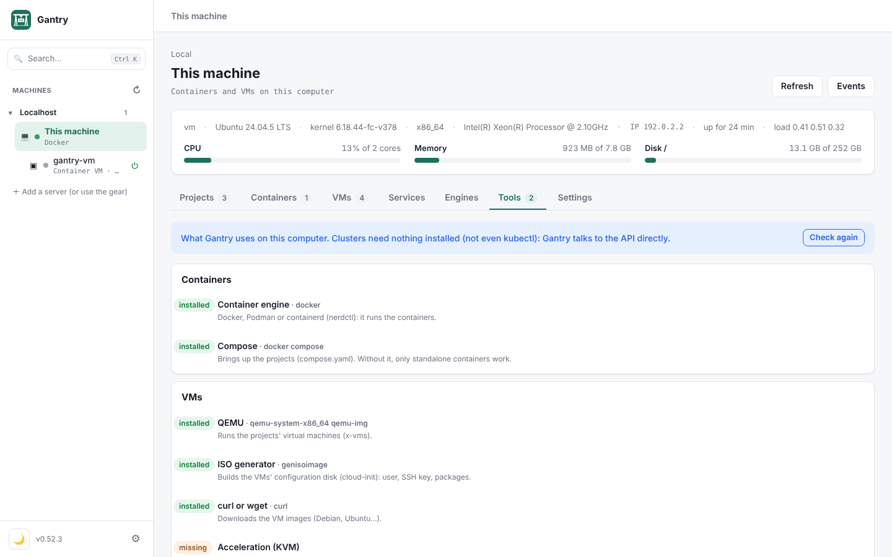

> **Where each thing runs.** Containers, VMs and Dynamips routers run on the Mac and on Linux. **IOL** devices and **VPCS** (the lab computer of case 4) need Linux x86_64: this computer, if it runs Linux, or a server over SSH (see [Add a server over SSH](guide/README.md#3-add-a-server-over-ssh)). The steps are the same either way; only the machine you pick changes.

## 2. The Container VM: containers on the Mac

The Mac does not run Linux containers directly: they need a Linux underneath. The **Container VM** is that Linux, created and looked after by Gantry itself. It is a small Debian VM, on Apple Virtualization, just for the engines: **Docker**, **Podman** and **containerd** (with `nerdctl`), one, two or all three. Its containers show up as containers of this Mac, and it keeps running with Gantry closed.

What it brings:

- **Dynamic memory:** the machine keeps only the memory the containers use, plus some room; the rest goes back to the Mac. When it needs more, it takes it at once, up to the maximum memory.
- **Your folders at the same path:** your home folder shows up inside the machine at the same place, so `./folder:/data` in a compose works as on Linux.
- **Data apart from the system:** images, volumes and containers live on a data disk that is never recreated, with an automatic snapshot a day. The system can be replaced without losing anything.
- **amd64 through Rosetta**, to run and build Intel images on an Apple Silicon Mac, and the **Mac's ssh-agent** forwarded, for `git clone` and `buildx --ssh` with your keys.
- **A script you read first:** everything that runs inside the machine is in a script you approve. If the script changes, Gantry does not run it.

### 2.1 Create the machine

1. Open **This machine** › **Engines** tab › **Create the Container VM**. On a Mac with no engine at all, the sidebar also shows **＋ Create Container VM**.
2. **Configure:**
   - **Name:** keep `gantry-vm` (lowercase letters, numbers and hyphens).
   - **Container engines:** tick the ones you want. You can pick more than one.
   - **Resources:** CPUs, maximum memory and the maximum size of the data disk. The disk is a sparse file: it takes on the Mac only what is used. You can change all of this later.
   - **Architectures and credentials:** amd64 through Rosetta, other architectures through QEMU (slower) and the Mac's ssh-agent.
   - **Start and stop:** **Start when Gantry opens**.
   - **Your own steps** (optional): an extra script that runs last as root (`apt-get install -y htop`, for example).

   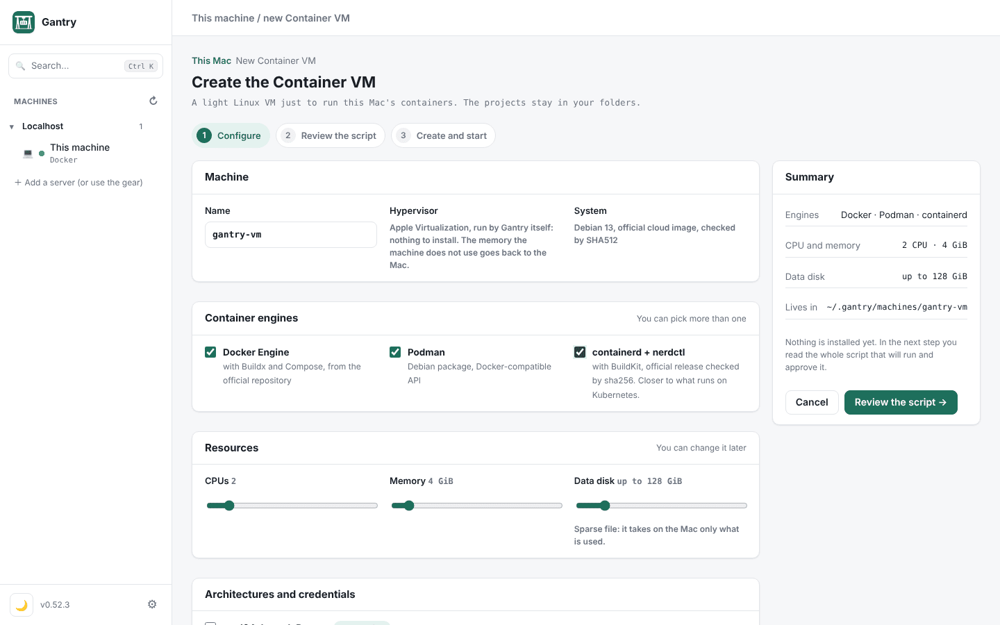

3. **Review the script:** the full `provision.sh`, with its sha256, and the cloud-init in a tab next to it. **Copy sha256** and **Download .sh** let you keep or check it elsewhere. The **What will happen** panel sums up the steps, on the Mac and inside the machine.

   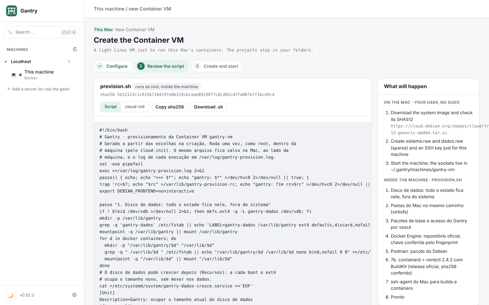

4. **Create and start:** Gantry downloads the Debian 13 image (checked by SHA512), creates the disks, starts the machine and shows the provisioning line by line. The first time it takes a few minutes, because it installs the engines.

When it finishes, the machine shows up in the sidebar, under **This machine**, with its power button next to it.

### 2.2 Use it from the Mac's terminal

The machine's **Engines and sockets** tab shows everything you need to use the engines outside Gantry:

- **Sockets on the Mac:** the machine's `docker.sock` and `podman.sock` live in `~/.gantry/machines/gantry-vm/`. containerd is used through the `nerdctl` command, in `~/.gantry/bin`.
- **Point the Mac's terminal:** `docker context use gantry` (recommended), or the `export DOCKER_HOST=…` and `export CONTAINER_HOST=…` lines for one session only. **Make it docker's default** switches the context for you.
- **Integration with the Mac:** each option is a box you turn on or off:
  - the `gantry` context in Docker;
  - a Docker context that talks to the machine's Podman;
  - **The machine's commands on the PATH**, which puts `docker`, `podman` and `nerdctl` from `~/.gantry/bin` in your terminal, after the ones the Mac already has;
  - **Link at /var/run/docker.sock**, for tools that only look there (asks for the administrator password).

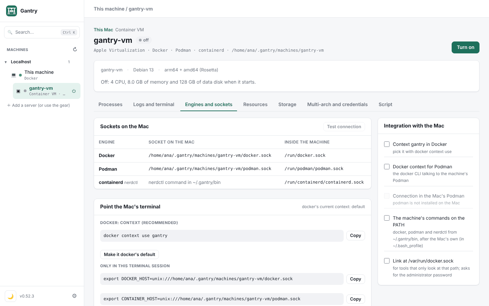

To test, in a Mac terminal:

```sh
docker context use gantry
docker run --rm hello-world
podman run --rm docker.io/library/alpine echo "hello from podman"     # with the machine's commands on the PATH
nerdctl run --rm docker.io/library/alpine echo "hello from nerdctl"   # same
```

Gantry projects (the cases below) use the machine on their own: just pick its engine when creating the project.

### 2.3 Start, stop and adjust

- **Start and stop:** with the button next to the machine in the sidebar, or **Turn on** and **Turn off** on its page. When the Mac sleeps, the machine pauses with it and comes back when it wakes.
- **Resources:** CPUs and **Maximum memory** (they apply on the next boot), **Dynamic memory** (on by default; applies right away), **Turn off with no container running for** a while, and the data disk, which only grows. With the machine on, the panel shows how much it holds now and how much went back to the Mac.

  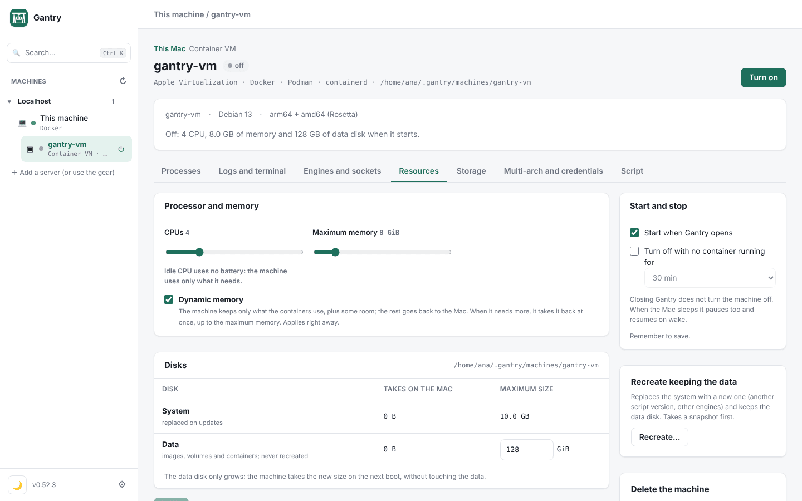

- **Processes:** what runs in the machine now, live, as in `htop`, grouped by container.
- **Logs and terminal:** the logs of the system, the engines and the provisioning, and a terminal inside the machine.
- **Storage:** the Mac folders the machine sees, the data disk snapshots (and going back to one) and the volumes in the Finder.
- **Multi-arch and credentials:** the platforms the machine runs and builds (`docker buildx build --platform linux/amd64,linux/arm64`) and the Mac credentials it uses.
- **Script:** the approved script. **Recreate…** (in the Resources tab) replaces the system with a new one, with other choices, and keeps the data disk.

> On Linux, the Container VM is not needed: the engine runs right on the system. On Windows, Gantry uses WSL2.

## 3. Create the folders on the computer

Two folders are enough:

- `~/gantry`: where the projects live, one folder per project. It is the folder Gantry already suggests when creating a project.
- `~/gantry/imagens`: where the images Gantry does not download on its own go (the Cisco router images, for example). It is one of the image folders Gantry already looks in.

In the terminal (the same command on the Mac and on Linux):

```sh
mkdir -p ~/gantry/imagens
```

For each project, one folder inside `~/gantry`. The cases in this tutorial use these:

```sh
mkdir -p ~/gantry/meu-site                    # case 1: container
mkdir -p ~/gantry/minha-vm                    # case 2: VM
mkdir -p ~/gantry/meu-lab/equipamentos        # cases 3 and 4: routers and the full lab
```

Rather not use the terminal? In the Finder (or the Linux file manager), go to your home folder, create the `gantry` folder and, inside it, the others. The result is the same.

A project looks like this:

```
~/gantry/meu-lab/
├── compose.yaml          the project: containers, VMs, devices, cables
├── .env                  variables (ports, passwords), optional
└── equipamentos/         the startup configuration of each network device
    ├── R1.cfg
    └── PC1.vpc
```

Gantry also creates a `.gantry/` folder inside the project, with files it generates when bringing the project up. You do not need to touch it. The VM disks and the routers' memory (NVRAM) live outside the project, in `~/.local/state/gantry/`.

**On a server over SSH**, the folders are created on the server, not on your computer. Create them from its terminal (`ssh homelab mkdir -p ~/gantry/imagens`) or leave it to Gantry: when you choose a project folder on a server, Gantry's picker lists the server's folders and creates new ones.

## 4. Two ways to create: the wizard or the file

Every project ends up as a `compose.yaml`. You can get there in two ways, and mix them whenever you like:

| | The wizard (**Create project**) | The file (**Open folder with compose**) |
|---|---|---|
| How | Gantry asks, shows the YAML and writes the folder | You write the `compose.yaml` in your editor and open the folder in Gantry |
| Good for | Starting fast, using a ready-made template, converting a `docker run` | Controlling every line, copying from an existing lab, versioning in git |
| Where | Projects › **＋ Create project** | Projects › **Other ways** › **Open folder with compose** |

The cases below show both paths. Once created, the project is the same, wherever it came from.

## 5. Case 1: a container

A static site on Nginx, opened in the browser.

### With the wizard

1. In the sidebar, click **This machine** › **Projects** tab › **＋ Create project**.
2. **Type:** choose **Containers**.
3. **Settings:** pick the engine (Docker or Podman) and, under **Template**, **Nginx**.
4. **Review and generate:**
   - **Name:** `meu-site`.
   - **Folder on the host:** Gantry suggests `~/gantry/meu-site`. Use **Choose…** to point to another folder.
   - **Target machine:** this machine (or a server).
   - If a template port is already in use on the machine, its field already comes with the next free one, with the reason below it.
   - Leave **Bring up after generating** ticked and click **Generate project**.

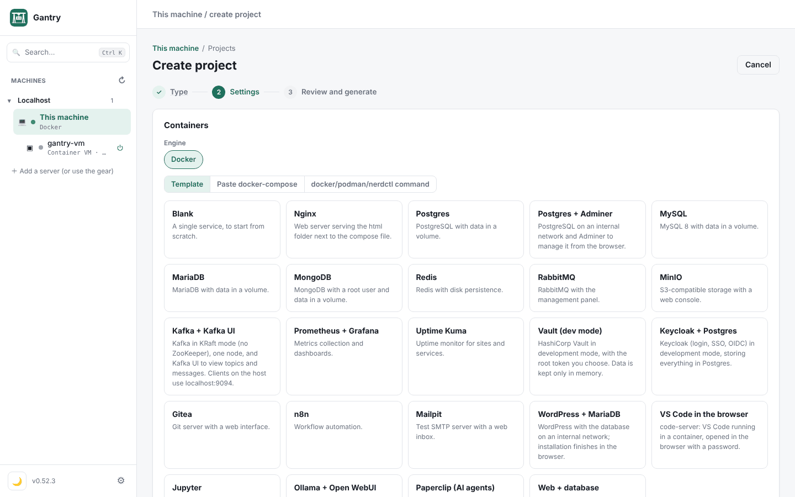

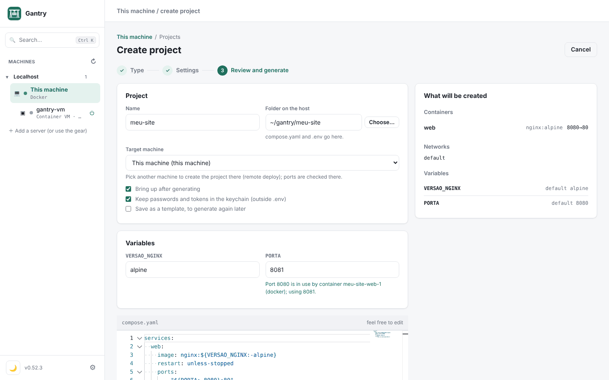

Gantry writes `compose.yaml` and `.env` to the folder, brings the container up and opens the project page.

### With the file

1. Create `~/gantry/meu-site/compose.yaml`:

   ```yaml
   name: meu-site
   services:
     web:
       image: nginx:1.27-alpine
       ports: ["${WEB_PORTA:-8080}:80"]
       volumes: ["./site:/usr/share/nginx/html:ro"]
   ```

2. Create the page, in `~/gantry/meu-site/site/index.html`:

   ```html
   <h1>Hello from Gantry</h1>
   ```

3. In Gantry: **This machine** › **Projects** › **Other ways** › **Open folder with compose**. Choose `~/gantry/meu-site` and click **Bring up**.

   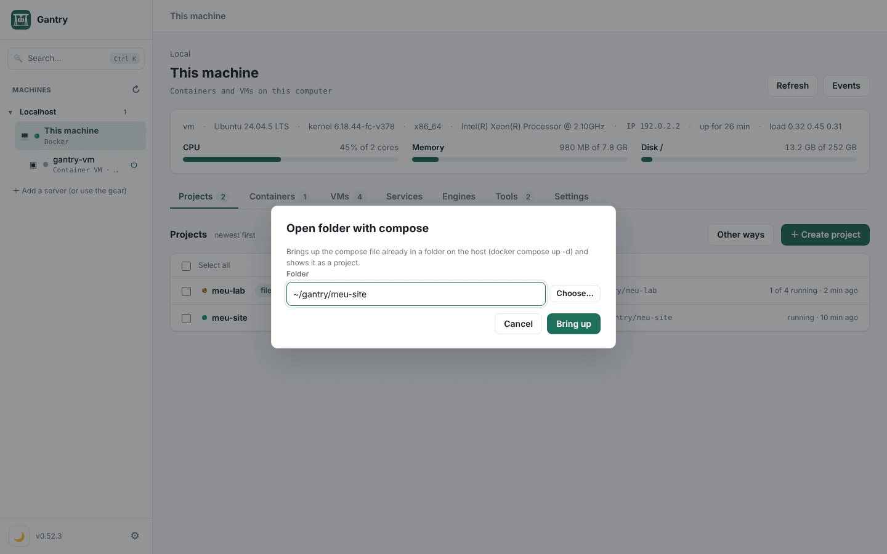

### Use and check

- The **Open** strip, at the top of the project, has the site link (`http://localhost:8080`). **Copy link** gives the address through the machine's IP, to open it on your phone.
- In the container list, **Logs** shows the requests live and **Shell** opens a terminal inside the container.
- Click the container name to see its ports, volumes, variables, CPU, memory and files.

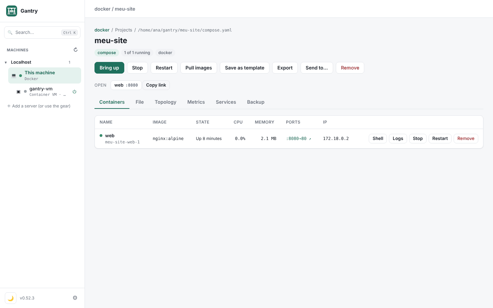

### Change something

To change the port, open the **File** tab, pick `.env` and change the port variable: `PORTA=8081` in the project made from the template, or `WEB_PORTA=8081` in the hand-written compose. Click **Save and apply**. Only `web` is recreated.

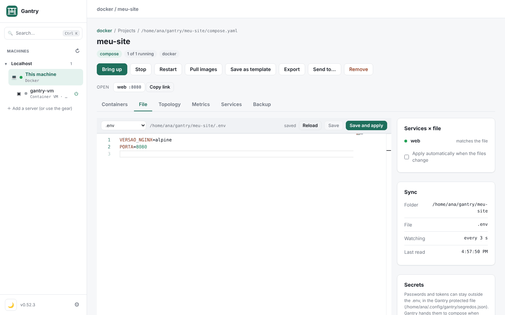

If you prefer your own editor (Nvim, VS Code), edit the file right in the folder. Gantry reads the folder again every 3 s and shows **The project files changed**, with the **Apply now** button.

> **A container outside a project.** For a quick test, **Other ways** › **Standalone container** opens the full form (image, ports, volumes, network, variables, limits), as in Portainer. The container does not live in a folder; to keep it and repeat it, use a project.

## 6. Case 2: a virtual machine

A Debian VM with Nginx, which your computer's browser opens at `http://localhost:8081`.

### With the wizard

1. **This machine** › **Projects** › **＋ Create project** › **Virtual machine**.
2. Pick a **Ready-made template** (Debian, Ubuntu with Docker, k3s, Rocky, NixOS, LAMP, from an ISO) or **Own setup**. In your own setup:
   - **VM name:** `web`.
   - **System:** Debian 12.
   - **Memory:** 1 GB. **Disk:** 8 GB.
   - **Ports:** `8081:80` (port 8081 of the computer leads to port 80 of the VM).
   - **Packages:** `nginx`.
   - **Startup script:** commands that run once, as root, on the first boot. The **Examples** include Docker, Podman, Nginx, k3s, time zone and a user with a password.
3. **Review and generate:** name `minha-vm`, folder `~/gantry/minha-vm`, **Generate project**.

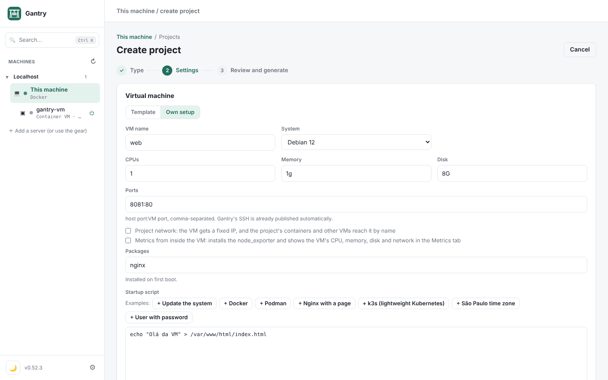

### With the file

Create `~/gantry/minha-vm/compose.yaml`:

```yaml
name: minha-vm
x-vms:
  web:
    image: debian-12          # ou debian-13, ubuntu-24.04, rocky, uma URL, um .qcow2
    cpus: 1
    memory: 1g
    disk: 8G
    ports: ["8081:80"]        # porta do computador → porta da VM
    packages: [nginx]         # instalados no primeiro boot
    run:                      # comandos no primeiro boot, como root
      - echo "Olá da VM" > /var/www/html/index.html
```

Then **Other ways** › **Open folder with compose** › `~/gantry/minha-vm` › **Bring up**.

### What happens when it comes up

The first time, Gantry:

1. downloads the Debian image once to `~/.cache/gantry/images` (the next VMs use the same one);
2. creates a disk for this VM only, which keeps just what changes from the image;
3. generates the cloud-init with the `gantry` user and an SSH key;
4. starts the VM on QEMU (HVF on the Mac, KVM on Linux).

The first boot takes a minute or two, because it installs the packages. Open **Console** to follow it: it shows the boot and cloud-init before SSH answers.

### Use and check

The project page has the **Devices** › **Virtual machines** tab. On the VM's row:

- **Shell**: a terminal inside the VM, over SSH, with no password. Clicking the SSH port copies the `ssh` command for your own terminal.
- **Logs**: the VM's `journalctl -f`.
- **Console**: the serial output.
- **Screen**: VNC, for systems with a graphical interface or an ISO install.
- **Manage…**: snapshots (with the VM on, they keep the memory too), growing the disk, cloning and starting with the machine.

Open `http://localhost:8081`: the page says "Olá da VM".

### Change something

- **CPU, memory and ports:** change them in `compose.yaml`, apply and restart the VM.
- **Packages, `run` and `cloud-init`:** only apply to a new VM. Remove the VM (its disk is deleted) and bring it up again. Take a snapshot first if there is something on it you want to keep.

> **Installing from an ISO.** For a system without a cloud image (Windows, your own installer), use the **from an ISO** template: the VM starts with an empty disk and boots the installer. Use **Screen** to install. **Import disk…**, in Create project, turns an OVA, VMDK, VDI or VHD(X) from another hypervisor into a VM.

## 7. Case 3: routers

Two Cisco 7200 routers (Dynamips) linked by a cable, each with its startup configuration in a file. Dynamips runs on the Mac and on Linux.

```
R1 Fa0/0 ──── r1-r2 ──── Fa0/0 R2
10.0.12.1/30            10.0.12.2/30
```

### 7.1 The router image

Cisco images do not come with Gantry (the license does not allow it). Use your own 7200 IOS file, a `c7200-….image` or `.bin`.

1. Copy the file to the image folder:

   ```sh
   cp ~/Downloads/c7200-adventerprisek9-mz.152-4.S6.image ~/gantry/imagens/
   ```

2. In Gantry: **This machine** › **Settings** tab › **Images** block › **Look again**. The image shows up in the list, with its kind recognized from the file name.

The Images block also lets you add other folders (**+ Folder**), if your images already live elsewhere.

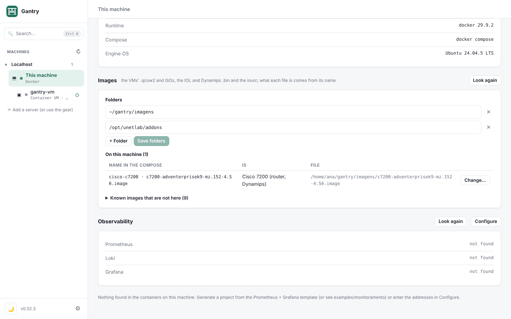

### 7.2 The startup configuration

Create `~/gantry/meu-lab/equipamentos/R1.cfg`:

```
hostname R1
interface FastEthernet0/0
 ip address 10.0.12.1 255.255.255.252
 no shutdown
end
```

And `~/gantry/meu-lab/equipamentos/R2.cfg`:

```
hostname R2
interface FastEthernet0/0
 ip address 10.0.12.2 255.255.255.252
 no shutdown
end
```

The startup configuration only goes in on the **first boot**. After that, what the router saved (`write memory`) is what counts.

### 7.3 The compose

Create `~/gantry/meu-lab/compose.yaml`:

```yaml
name: meu-lab
x-vms:
  R1:
    image: cisco-c7200            # acha o .image na pasta de imagens
    interfaces: [r1-r2]           # a primeira porta (Fa0/0) no cabo r1-r2
    config: equipamentos/R1.cfg
  R2:
    image: cisco-c7200
    interfaces: [r1-r2]           # mesmo nome de cabo: R1 e R2 estão ligados
    config: equipamentos/R2.cfg
```

How the cables work:

- `interfaces:` lists the device's ports, in order, and the cable of each one.
- On the 7200, the order is `Fa0/0`, then `Fa1/0`, `Fa1/1`, and so on. Gantry only puts in the router the cards the cables use.
- `none` leaves a port without a cable, to skip a port and wire the next one.

### 7.4 Bring it up and get into the router

1. **Other ways** › **Open folder with compose** › `~/gantry/meu-lab` › **Bring up**.
2. Open the **Topology** tab: the lab is drawn, with R1 and R2 linked by the cable. The light at each end turns green with the interface up.
3. Double-click R1 (or right-click › **Console**) to open the router console, as in GNS3.
4. Test:

   ```
   R1# show ip interface brief
   R1# ping 10.0.12.2
   ```


### 7.5 The idle-PC (so the router does not use a whole core)

Without an idle-PC, Dynamips uses a whole processor thread, even with the router idle at the prompt. The VM list shows **no idle-PC** next to the router.

1. With the router on and at the prompt (`R1>`), click **no idle-PC** (or **Manage…** › **Compute idle-PC**).
2. The value is kept for the image and applies to every router using it: you only do it once.

### 7.6 Keep what you configured

- `write memory` on the router writes its NVRAM. The project's `R1.cfg` does not change.
- **Devices** › **Lab states** › **Save state…** keeps the configuration of every device at once. **Restore** takes them all back to that point. Use it before trying something risky.
- **Start from scratch…** deletes what the routers saved, and they boot from the `config:` files again.

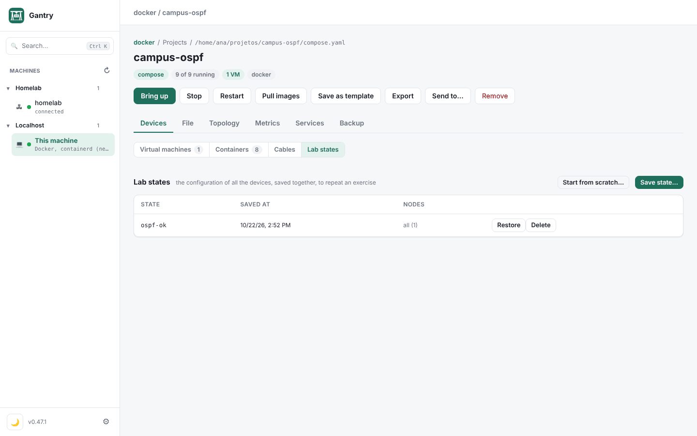

### Variation: IOL (on Linux x86_64)

IOL runs IOS as a Linux program, much lighter than Dynamips. Change `image:`:

```yaml
x-vms:
  R1:
    image: cisco-iol              # roteador (L3); cisco-iol-l2 para um switch
    interfaces: [r1-r2]           # Ethernet0/0, 0/1, 0/2, 0/3, depois 1/0…
    config: equipamentos/R1.cfg
```

- Copy the IOL `.bin` to `~/gantry/imagens` (on the server, if the lab runs on a server).
- If the image asks for a license, put the `iourc` file in the same folder.
- In `R1.cfg`, the interface is now called `Ethernet0/0`.
- IOL does not need an idle-PC.

Cards, NPE, memory and more models are in [Network equipment](network-labs.md).

## 8. Case 4: everything in one lab

Now `meu-lab` grows: two LANs, a lab computer (VPCS) on LAN A, and a container and a VM on LAN B. A ping from the PC crosses both routers to the server.

```
                 r1-r2 (10.0.12.0/30)
        R1 Fa0/0 ─────────────── Fa0/0 R2
     Fa1/0 │                         │ Fa1/0
           │ lan-a 10.0.1.0/24       │ lan-b 10.0.2.0/24
         PC1 .10              srv .10 (container)   web .20 (VM)
```

This case uses VPCS, so run the lab on **Linux x86_64** (this computer or a server). On a server, create the folders and copy the images there (section 3), and pick the server when opening the folder.

### 8.1 The files

`equipamentos/R1.cfg`, now with LAN A and the route to LAN B:

```
hostname R1
interface FastEthernet0/0
 ip address 10.0.12.1 255.255.255.252
 no shutdown
interface FastEthernet1/0
 ip address 10.0.1.1 255.255.255.0
 no shutdown
ip route 10.0.2.0 255.255.255.0 10.0.12.2
end
```

`equipamentos/R2.cfg`:

```
hostname R2
interface FastEthernet0/0
 ip address 10.0.12.2 255.255.255.252
 no shutdown
interface FastEthernet1/0
 ip address 10.0.2.1 255.255.255.0
 no shutdown
ip route 10.0.1.0 255.255.255.0 10.0.12.1
end
```

`equipamentos/PC1.vpc`, the lab computer (address, gateway and mask):

```
ip 10.0.1.10 10.0.1.1 24
```

And the full `compose.yaml`:

```yaml
name: meu-lab

# As redes do lab: cada uma é um switch.
x-redes:
  lan-a: {subnet: 10.0.1.0/24, gateway: 10.0.1.1}
  lan-b: {subnet: 10.0.2.0/24, gateway: 10.0.2.1}

x-vms:
  # Roteadores (Dynamips)
  R1:
    image: cisco-c7200
    interfaces: [r1-r2, lan-a]          # Fa0/0 no cabo, Fa1/0 na lan-a
    config: equipamentos/R1.cfg
  R2:
    image: cisco-c7200
    interfaces: [r1-r2, lan-b]          # Fa0/0 no cabo, Fa1/0 na lan-b
    config: equipamentos/R2.cfg

  # Computador de lab
  PC1:
    image: vpcs                         # vem com o Gantry
    interfaces: [lan-a]
    config: equipamentos/PC1.vpc

  # VM Debian com Nginx, na lan-b
  web:
    image: debian-12
    cpus: 1
    memory: 1g
    disk: 8G
    ports: ["8081:80"]
    packages: [nginx]
    interfaces: [{rede: lan-b, ip: 10.0.2.20/24}]   # segunda placa, na lan-b
    run:
      - echo "Olá da VM" > /var/www/html/index.html
      # a volta para a lan-a passa pelo R2, também depois de reiniciar
      - printf '[Unit]\nAfter=network-online.target\nWants=network-online.target\n[Service]\nType=oneshot\nExecStart=/sbin/ip route replace 10.0.1.0/24 via 10.0.2.1\n[Install]\nWantedBy=multi-user.target\n' > /etc/systemd/system/rota-lab.service
      - systemctl enable --now rota-lab.service

services:
  # Container com um servidor web, na lan-b
  srv:
    image: busybox:1.36
    cap_add: [NET_ADMIN]                # para criar a rota até a lan-a
    command:
      - sh
      - -c
      - |
        until ip link show eth1 >/dev/null 2>&1; do sleep 1; done
        ip route replace 10.0.1.0/24 via 10.0.2.1
        mkdir -p /www && echo "Olá do container" > /www/index.html
        exec httpd -f -p 80 -h /www
    x-interfaces: [{rede: lan-b, ip: 10.0.2.10/24}] # vira a eth1 do container
    x-icon: server
```

What each new part is:

- `x-redes` creates the LANs. A network joins many ports, like a switch; a cable (`r1-r2`) links only two.
- On devices, `interfaces:` takes the name of a cable or of a network.
- On VMs, `interfaces:` adds NICs after the first one. The first one still gives internet, SSH and the published ports; `ip:` sets the address of the new NIC.
- On containers, `x-interfaces:` adds ports (`eth1`, `eth2`…) on the lab's cables and networks.
- The container and the VM already have a way out (through their main NIC). That is why each one gets a route to LAN A through R2; without it, the ping arrives but the reply never comes back.

### 8.2 Bring it up

If `meu-lab` from case 3 is already open, save the files: the project page shows **The project files changed**, with what changes in each service and VM. Click **Apply now**. If you have not opened it yet, use **Open folder with compose** as before.

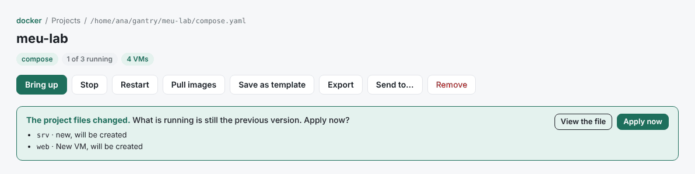

The routers created before keep the NVRAM from case 3, so the new configuration in the files does not go in on its own. Use **Devices** › **Lab states** › **Start from scratch…** and bring the lab up again, or type the new lines in the console.

The **Topology** tab shows the whole lab: the routers, the PC, the container, the VM, the two network clouds and the cables. Each device's light turns green when it is on; the example in `examples/primeiro-lab` also brings the drawing positions (`pos:` and `x-pos:`).

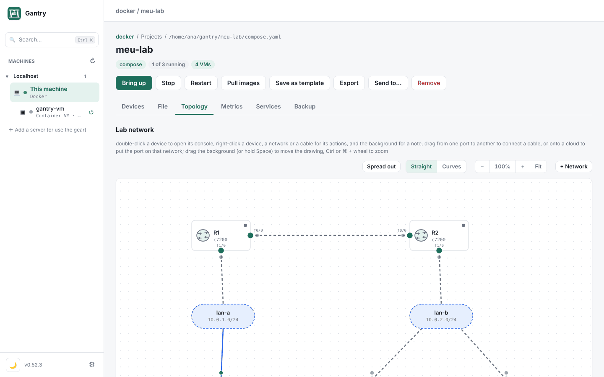

### 8.3 Test

1. Right-click **PC1** › **Console**:

   ```
   PC1> ping 10.0.1.1       # R1
   PC1> ping 10.0.2.10      # the container, beyond both routers
   PC1> ping 10.0.2.20      # the VM
   PC1> trace 10.0.2.10     # shows the path: R1, R2, srv
   ```

2. **Shell** on the `web` VM:

   ```sh
   ping -c 3 10.0.1.10                 # PC1
   wget -qO- http://10.0.2.10          # the container's site: "Olá do container"
   ```

3. In your computer's browser, `http://<machine>:8081` opens the VM's Nginx, through the published port.

### 8.4 See the traffic

Click a cable (or right-click a network cloud) › **Watch live here**. The capture opens in the bottom panel, decoded line by line. Run the ping again and watch the packets go by. **Save .pcap…** keeps the capture to open in Wireshark.

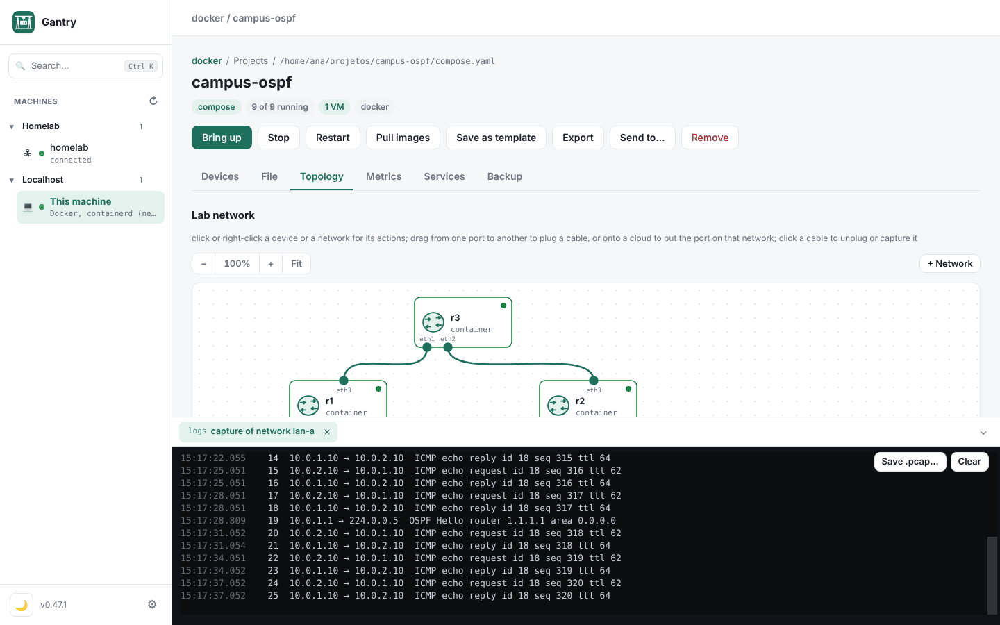

Nothing needs to be installed on the devices: the capture runs on the lab's machine.

## 9. Changing the lab later

You can change the lab from the interface or from the file. The result goes to the same `compose.yaml`:

- **From the Topology:**
  - drag from one port to another to connect a cable;
  - drag a port onto a cloud to put that port on a network;
  - **+ Network** creates a new network (with optional subnet and DHCP);
  - right-clicking a device gives console, shell, logs, start and stop;
  - right-click the background › **New note** puts a text on the drawing.

  Positions and icons are kept in the compose too (`x-pos`, `x-icon`).
- **From the Cables tab** (under **Devices**): the ports of each device, where each one is connected and its address, with the same editing.
- **From the file:** edit `compose.yaml` in the **File** tab or in your editor. When the files change, the project page tells you, shows what changes in each service and VM, and waits for you to click **Apply now**. Running VMs only restart if you tick it.

To add another device, copy the block of a similar one, change the name and the cables, and apply. For another router, create its `.cfg` in `equipamentos/` too.

## 10. Organize, keep and take it elsewhere

- **Folders in the sidebar:** gear › **Folders** creates folders (per client, course, environment) and **Machines** puts each machine in its folder. They are sidebar folders, not disk folders.
- **Save as template:** on the project page. The project shows up first in **Create project**, marked "yours", to generate it again the same way.
- **Export:** a `.tar.gz` of the project folder (the `.env` only if you tick it). **Import package**, under **Other ways**, opens the package on another machine.
- **Send to…:** copies the project to another machine and brings it up there.
- **Backup:** the **Backup** tab keeps volumes, databases and the project folder in one file, in the folder you choose, and can run on its own.
- **git:** since the project is just a folder of text files, you can version it with `git init` and bring it back with **Other ways** › **Project from a git repository**. Keep `.gantry/` and `.env` out of the repository (`.gitignore`).

## 11. When something does not work

| What shows up | What to do |
|---|---|
| The port is already in use | The wizard already picks another one. In a project opened from the file, the output says who uses the port and which variable to change in `.env`. |
| "the image … is not on this machine" | Copy the file to `~/gantry/imagens` (on the lab's machine) and click **Look again**, or add the folder where it is. |
| `qemu`, `dynamips` or `python3` is missing | The machine's **Tools** tab: the install command, or the button on the Mac. |
| The VM does not answer in Shell | Open **Console**: cloud-init may still be installing packages, or show an error. Wait for the boot to finish. |
| The `.cfg` configuration did not go in | It only applies on the first boot. Use **Start from scratch…** in Lab states, or configure it from the console. |
| The router shows **N lines refused** | Click it: each line IOS rejected appears with its message. |
| The processor stays at 100% with the router idle | The idle-PC is missing: **Manage…** › **Compute idle-PC** (section 7.5). |
| The 7200 refuses the memory | The 7200 goes up to 256 MB on Dynamips; above that it does not start. |
| The ping goes out but no reply comes back | A return route is missing: check the routes on the routers, the container and the VM (section 8.1). |
| IOL or VPCS do not start on the Mac | They need Linux x86_64. Use a server over SSH, or Dynamips instead of IOL. |

To ask for help, gear › **General** › **View diagnostics** gathers versions, the state of the machines and the end of the log, without addresses, users or passwords.

## 12. Summary: the files of each case

```
~/gantry/
├── imagens/
│   └── c7200-adventerprisek9-mz.152-4.S6.image   your 7200 image (and the IOL .bin, the iourc)
├── meu-site/                    case 1
│   ├── compose.yaml
│   └── site/index.html
├── minha-vm/                    case 2
│   └── compose.yaml
└── meu-lab/                     cases 3 and 4
    ├── compose.yaml
    └── equipamentos/
        ├── R1.cfg
        ├── R2.cfg
        └── PC1.vpc
```

The files of case 4 are also in [`examples/primeiro-lab`](../examples/primeiro-lab), ready to open with **Open folder with compose** (only your 7200 image in the image folder is missing).

Next steps: the [guide](guide/README.md) shows the other features with screenshots (metrics, shared services, Kubernetes, AI assistants), and [Network equipment](network-labs.md) goes deeper into IOL, Dynamips, VPCS and importing PNETLab and EVE-NG labs.
