# Guia do Gantry

[English](../guide/README.md) · **Português** · [Referência](../referencia.md) · [Voltar ao início](../../README.pt-BR.md)

Um passeio pelo Gantry com casos reais, da primeira abertura a um lab de rede com roteadores. Cada parte se sustenta sozinha: vá direto à que você precisa.

As telas vêm de um ambiente de demonstração: este computador com Docker, Podman e containerd, um servidor chamado `homelab` acessado por SSH, um projeto web pequeno (`webshop`) e um lab de OSPF (`campus-ospf`).

**Conteúdo**

1. [Primeira abertura](#1-primeira-abertura)
2. [Uma máquina e os projetos dela](#2-uma-máquina-e-os-projetos-dela)
3. [Adicionar um servidor via SSH](#3-adicionar-um-servidor-via-ssh)
4. [Criar um projeto a partir de um modelo](#4-criar-um-projeto-a-partir-de-um-modelo)
5. [Trazer um compose ou um `docker run` que você já tem](#5-trazer-um-compose-ou-um-docker-run-que-você-já-tem)
6. [Editar o compose e aplicar a mudança](#6-editar-o-compose-e-aplicar-a-mudança)
7. [Containers: logs, shell, arquivos](#7-containers-logs-shell-arquivos)
8. [Métricas](#8-métricas)
9. [Caso: um lab de OSPF com roteadores, um PC e um servidor](#9-caso-um-lab-de-ospf-com-roteadores-um-pc-e-um-servidor)
10. [Capturar o tráfego de um cabo](#10-capturar-o-tráfego-de-um-cabo)
11. [Estados do lab: guardar o exercício e voltar](#11-estados-do-lab-guardar-o-exercício-e-voltar)
12. [Caso: importar um lab do PNETLab ou do EVE-NG](#12-caso-importar-um-lab-do-pnetlab-ou-do-eve-ng)
13. [Máquinas virtuais](#13-máquinas-virtuais)
14. [Backup e restauração](#14-backup-e-restauração)
15. [Clusters Kubernetes](#15-clusters-kubernetes)
16. [Ferramentas: o que falta em cada máquina](#16-ferramentas-o-que-falta-em-cada-máquina)
17. [Configuração e assistentes de IA](#17-configuração-e-assistentes-de-ia)

## 1. Primeira abertura

Instale o Gantry (veja [Baixar](../../README.pt-BR.md#baixar)) e abra. Sem servidores nem clusters seus ainda, a tela de boas-vindas mostra:

- o que o Gantry achou neste computador (Docker, Podman, containerd, QEMU) e o que falta;
- os servidores do seu `~/.ssh/config`, um clique cada para adicionar;
- os clusters do seu `~/.kube/config`, do mesmo jeito;
- um primeiro projeto: um Postgres + Adminer de teste, com a senha já criada.

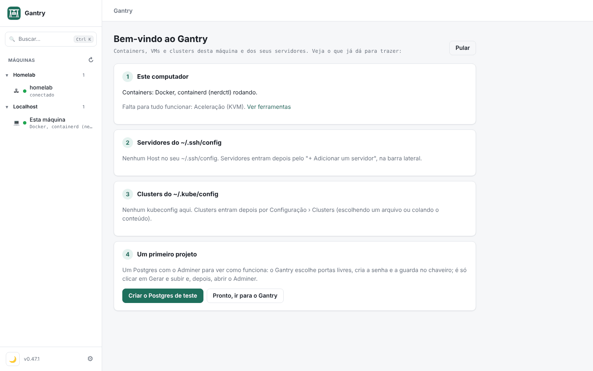

**Pular** vai direto ao app. As boas-vindas voltam pela engrenagem › **Geral** › Abrir as boas-vindas.

## 2. Uma máquina e os projetos dela

A barra lateral lista máquinas, não containers. **Esta máquina** junta todos os engines deste computador (Docker, Podman, containerd) numa entrada só. Pastas (aqui, *Homelab* e *Localhost*) agrupam as máquinas; a pasta mostra quantas máquinas tem e quantas estão com problema, mesmo fechada.

A página da máquina mostra o hardware e o uso de CPU, memória e disco, e depois as abas: **Projetos**, **Containers**, **VMs**, **Serviços**, **Engines**, **Ferramentas** e **Configuração**.

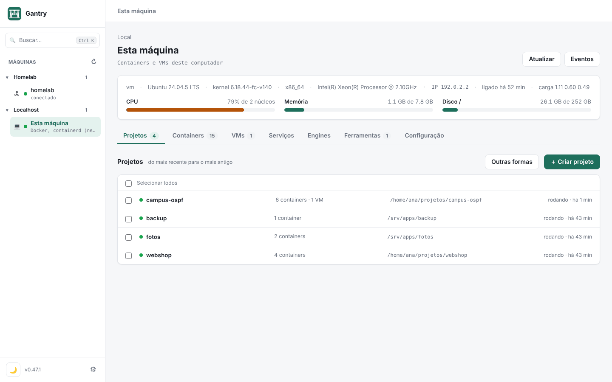

Todo projeto compose da máquina aparece, tenha sido criado pelo Gantry ou por um `docker compose up` no terminal: o Gantry lê as labels que o Compose grava. Containers fora de qualquer compose aparecem como avulsos.

Dica: **Ctrl K** (⌘K no Mac) abre uma busca em máquinas, projetos, containers e telas.

## 3. Adicionar um servidor via SSH

O Gantry chega nos servidores com o seu próprio SSH: chaves, apelidos do `~/.ssh/config`, jump hosts. Nada é instalado no servidor.

1. Engrenagem › **Máquinas** › **+ Adicionar máquina**.
2. Endereço: `ssh://homelab` (um apelido do `~/.ssh/config`) ou `ssh://ana@192.0.2.10:22`.
3. Escolha uma pasta para ele na barra lateral (opcional).

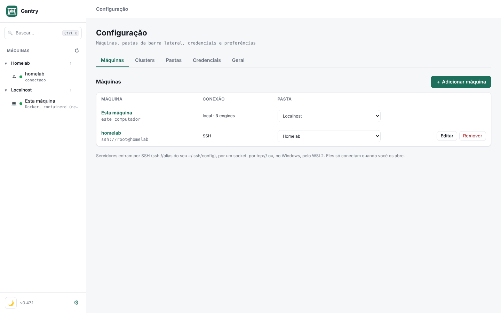

O servidor só conecta quando você abre. Senhas e frases das chaves são perguntadas no app. O Gantry procura o socket do Docker ou do Podman no servidor e o encaminha pela conexão SSH; no Podman sem root, oferece um botão para ligar o `podman.socket` do usuário.

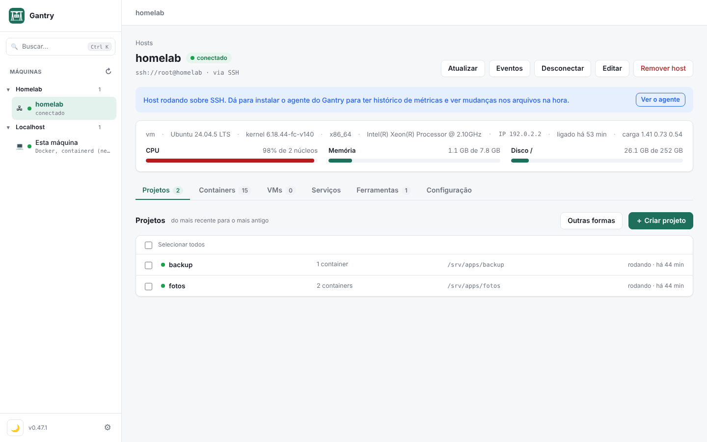

A faixa azul oferece o agente opcional: com ele, o servidor guarda 24 h de métricas mesmo com o app fechado, e o app fala com ele por uma conexão direta com TLS. Sem ele, tudo continua funcionando pelo SSH.

## 4. Criar um projeto a partir de um modelo

**Criar projeto** abre um assistente em três passos.

**Passo 1, Tipo:** containers, uma máquina virtual ou os dois.

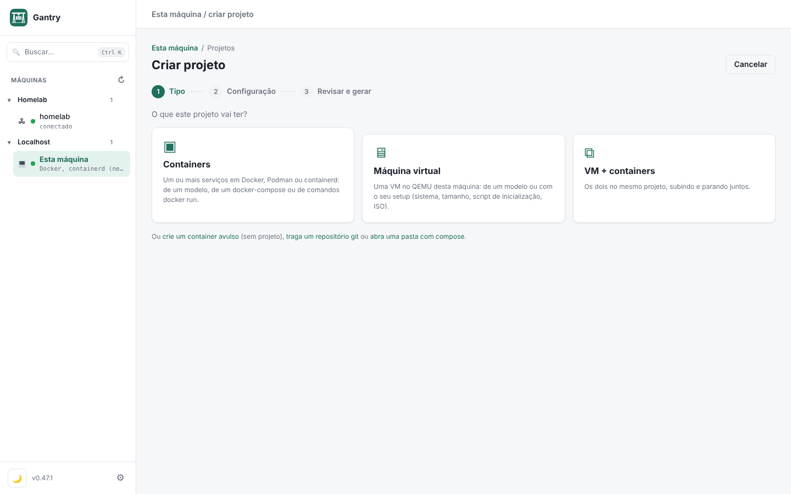

**Passo 2, Configuração:** o engine (Docker, Podman, containerd) e a origem:

- **Modelo**: mais de 30 projetos prontos, com versões fixas das imagens: bancos (Postgres, MySQL, MariaDB, MongoDB, Redis), filas (RabbitMQ, Kafka), monitoramento (Prometheus + Grafana, Uptime Kuma), identidade (Keycloak, Vault), ferramentas de desenvolvimento (Gitea, n8n, Mailpit, VS Code no navegador, Jupyter), IA (Ollama + Open WebUI) e labs de rede.
- **Colar docker-compose**: um compose que você já tem.
- **Comando docker/podman/nerdctl**: uma ou mais linhas de `docker run`, convertidas em compose.

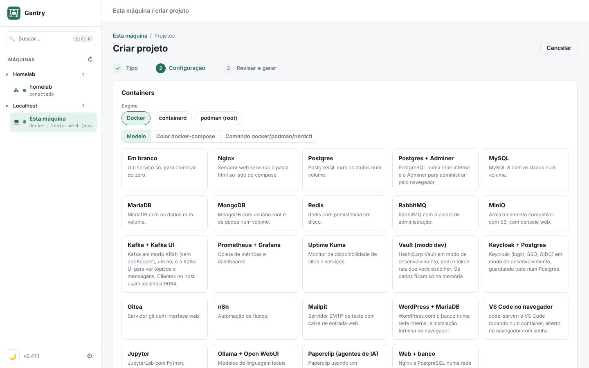

**Passo 3, Revisar e gerar:** o YAML, editável, com um resumo ao lado. As variáveis do modelo viram campos: as senhas são geradas e podem ir para o chaveiro do sistema em vez do `.env`. Variáveis de porta já em uso na máquina ganham a próxima porta livre, com o motivo embaixo do campo. Escolha o nome, a pasta e a máquina de destino (esta ou um servidor) e **Gerar projeto**.

**Caso prático: um Postgres para um projeto pessoal.** Criar projeto › Containers › **Postgres + Adminer** › **Gerar projeto**. O Gantry grava o `compose.yaml` e o `.env` na pasta do projeto, guarda a senha no chaveiro e sobe. A página do projeto mostra a faixa **Abrir** com o link do Adminer. Depois, em outro projeto, a aba **Serviços** oferece **Usar neste projeto…**: o Gantry cria um banco e um usuário só para aquele projeto no mesmo Postgres e grava a conexão no `.env` dele.

## 5. Trazer um compose ou um `docker run` que você já tem

Não precisa recriar nada:

- **Já está rodando?** Já aparece na lista. Abra para ver os containers; a aba Arquivo mostra o compose que o Gantry achou pelas labels do Compose.
- **Uma pasta com compose que não está rodando:** Projetos › **Outras formas** › Abrir pasta com compose. O Gantry sobe.
- **Um repositório git:** Outras formas › Projeto de um repositório git. Depois, a aba Arquivo mostra quantos commits novos o remoto tem.
- **Um `docker run` de um README:** Criar projeto › Containers › Comando docker/podman/nerdctl. Portas, volumes, variáveis, rede, limites, política de reinício e healthcheck viram compose; o que não tem equivalente vira aviso, então nada some calado.
- **Um pacote de outro Gantry:** Outras formas › Importar pacote (um `.tar.gz` feito com **Exportar**).

## 6. Editar o compose e aplicar a mudança

A página do projeto tem as ações no topo (**Subir**, **Parar**, **Reiniciar**, **Atualizar imagens**, **Salvar como modelo**, **Exportar**, **Enviar para…**, **Remover**), a faixa **Abrir** com as portas web e as abas.

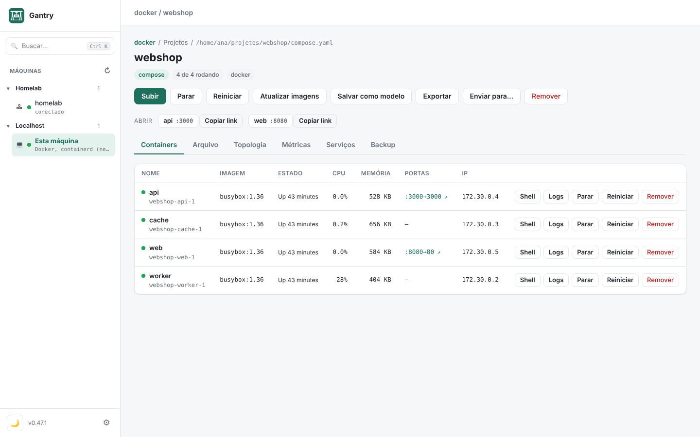

A aba **Arquivo** edita o `compose.yaml`, o `.env` e os outros arquivos de texto da pasta. O painel da direita compara cada serviço com o que está rodando.

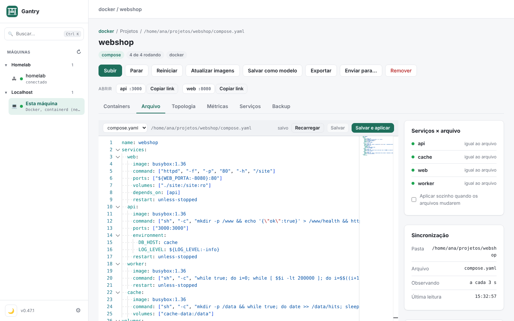

- **Salvar e aplicar** grava o arquivo e roda o `compose up` do que mudou.
- Se preferir, edite no seu editor (Nvim, VS Code): o arquivo é relido a cada 3 s, e a página avisa **Os arquivos do projeto mudaram**, com o que muda em cada serviço e o botão **Aplicar agora**. Se você editar nos dois lugares ao mesmo tempo, o app avisa do conflito.
- **Aplicar sozinho quando os arquivos mudarem** (desligado por padrão) aplica quando os arquivos param de mudar por alguns segundos. Arquivo com erro nunca é aplicado.

**Caso prático: trocar uma porta.** No `.env`, troque `WEB_PORTA=8080` por `8081` e **Salvar e aplicar**. Só o `web` é recriado; a faixa **Abrir** mostra a porta nova.

## 7. Containers: logs, shell, arquivos

Cada linha de container tem **Shell**, **Logs**, **Parar**, **Reiniciar** e **Remover**. Clicar no nome abre a página do container.

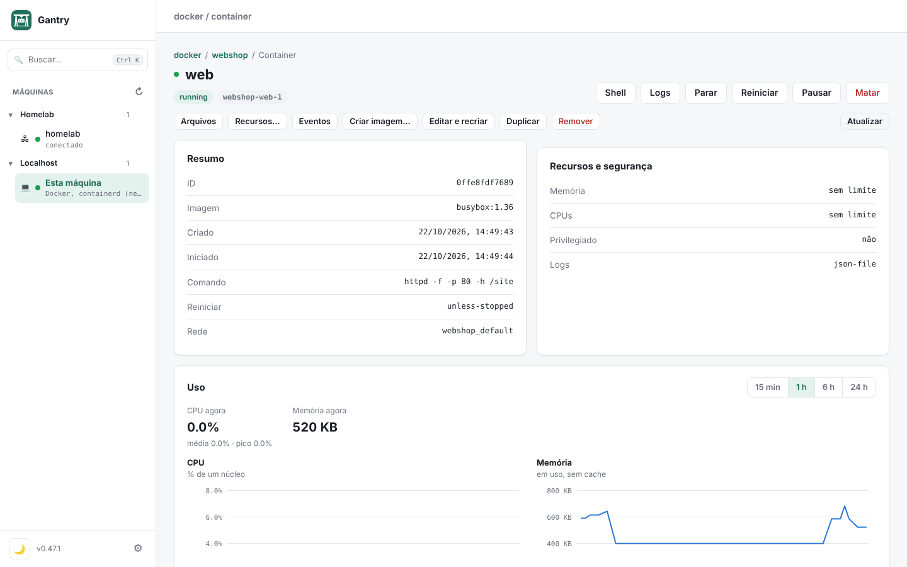

- **Logs**: ao vivo, com filtro de linhas, período (15 min a 24 h, ou tudo), hora de cada linha e **Salvar…** num arquivo.
- **Shell**: um terminal interativo dentro do app.
- **Arquivos**: navega pelas pastas do container, baixa (pastas vêm como `.tar`), envia deste computador, apaga. Funciona também com o container parado.
- **Recursos…**: muda CPU, memória e política de reinício sem recriar.
- **Editar e recriar** e **Duplicar**: o formulário completo, já com as opções atuais. O container antigo fica de lado até o novo subir; se algo falhar, ele volta.
- **Eventos**: criado, iniciado, encerrou com código, sem memória, na última 1 h, 24 h ou 7 dias.
- **Criar imagem…**: `docker commit` do estado atual.

## 8. Métricas

A aba **Métricas** de um projeto mostra gráficos de CPU e memória por container e por VM, de 15 minutos a 24 horas, com uma tabela de resumo. Clique num nome na legenda ou na tabela para destacar.

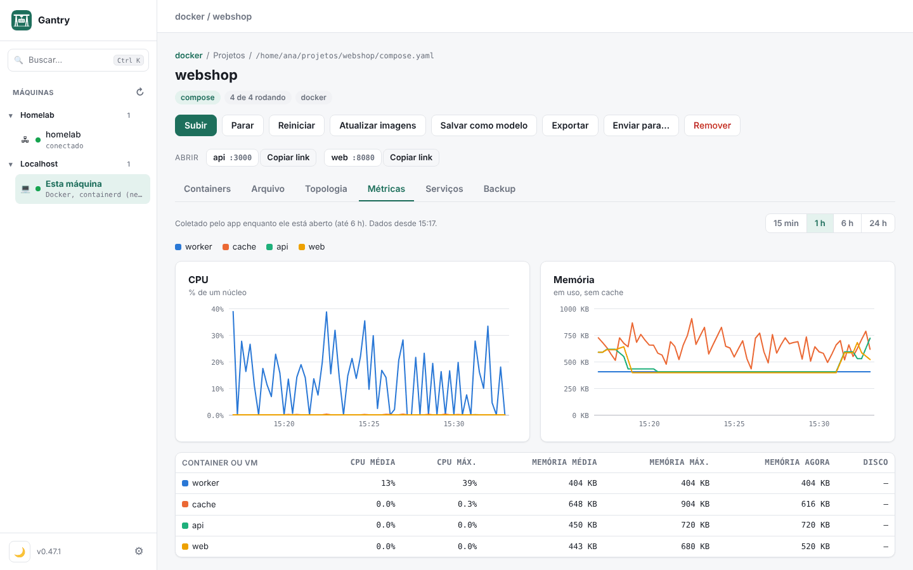

Sem o agente, o app coleta enquanto está aberto (até 6 h). Com o agente num servidor, o histórico fica lá, mesmo com o app fechado. Se houver um Prometheus perto da máquina, a aba também o oferece como fonte, com um campo para PromQL.

## 9. Caso: um lab de OSPF com roteadores, um PC e um servidor

Um lab de rede é um compose como outro qualquer. Este tem três roteadores FRR em containers, ligados em triângulo, duas LANs, um computador VPCS na LAN A e um servidor web na LAN B:

```yaml
name: campus-ospf
x-frr: &frr
  image: frrouting/frr:8.4.4
  command: ["sh", "/frr.sh"]          # inicia o zebra e o ospfd, área 0 em todas as interfaces
  volumes: ["./frr.sh:/frr.sh:ro"]
  cap_add: [NET_ADMIN, NET_RAW, SYS_ADMIN]
  sysctls: {net.ipv4.ip_forward: 1}
  x-icon: router
x-redes:                               # redes do lab: um switch cada
  lan-a: {subnet: 10.0.1.0/24, gateway: 10.0.1.1}
  lan-b: {subnet: 10.0.2.0/24, gateway: 10.0.2.1}
services:
  r1:
    <<: *frr
    environment: {RID: 1.1.1.1}
    x-interfaces: [{rede: lan-a, ip: 10.0.1.1/24}, {link: r1-r2, ip: 10.0.12.1/30}, {link: r1-r3, ip: 10.0.13.1/30}]
  r2:
    <<: *frr
    environment: {RID: 2.2.2.2}
    x-interfaces: [{link: r1-r2, ip: 10.0.12.2/30}, {rede: lan-b, ip: 10.0.2.1/24}, {link: r2-r3, ip: 10.0.23.1/30}]
  r3:
    <<: *frr
    environment: {RID: 3.3.3.3}
    x-interfaces: [{link: r1-r3, ip: 10.0.13.2/30}, {link: r2-r3, ip: 10.0.23.2/30}]
  srv-b:
    image: busybox:1.36
    x-interfaces: [{rede: lan-b, ip: 10.0.2.10/24}]
    x-icon: server
x-vms:
  pc1:
    image: vpcs                        # vem com o Gantry
    interfaces: [lan-a]
    config: pc1.vpc                    # ip 10.0.1.10 10.0.1.1 24
```

- `x-interfaces` num serviço acrescenta portas ao container: `link:` é um cabo ponto a ponto (duas pontas com o mesmo nome estão ligadas), `rede:` liga a porta numa rede do lab.
- `x-vms` tem os equipamentos de rede que não são containers: VPCS, Cisco IOL e Dynamips. O `interfaces:` deles lista os cabos na ordem das portas.
- O mesmo compose poderia usar roteadores Cisco no lugar do FRR: `image: cisco-iol` ou `cisco-c7200`. Tudo sobre eles (placas, NPE, memória, imagens) está em [Equipamentos de rede](../equipamentos-de-rede.md).

**Subir**, e a aba **Topologia** desenha o lab a partir do compose:

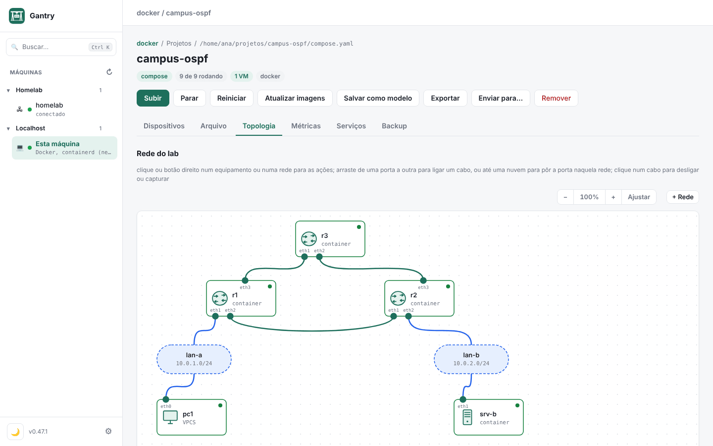

O desenho também é um editor: arraste de uma porta a outra para ligar um cabo, arraste uma porta até uma nuvem para pôr naquela rede, clique num cabo para desligar ou capturar, clique com o botão direito num equipamento para console, shell, logs, iniciar e parar. **+ Rede** cria uma rede do lab (um switch, com subnet e DHCP opcionais). Posições e ícones ficam gravados no compose (`x-pos`, `x-icon`).

A aba **Dispositivos** agrupa as partes do lab em sub-abas: **Máquinas virtuais** (aqui, o VPCS), **Containers**, **Cabos** e **Estados do lab**.

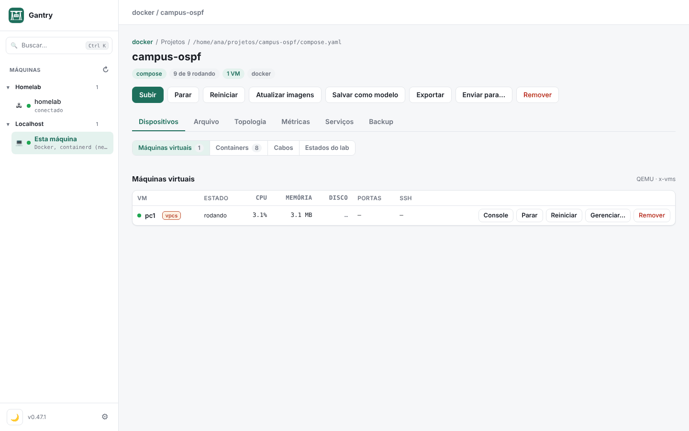

**Cabos** lista as portas de cada equipamento, onde cada uma está ligada e o endereço, com a mesma edição do desenho.

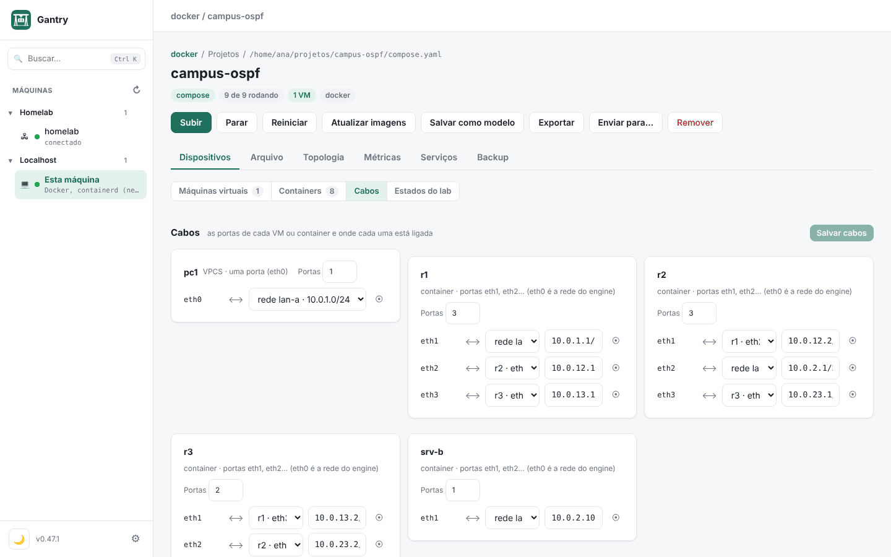

Para testar: botão direito no `pc1` › Console, e `ping 10.0.2.10`. O ping atravessa o r1 e o r2 assim que o OSPF converge (alguns segundos); `docker exec campus-ospf-r1-1 vtysh -c "show ip ospf neighbor"` ou o shell do r1 mostram os vizinhos.

## 10. Capturar o tráfego de um cabo

Clique num cabo (ou botão direito numa nuvem de rede) › **Ver ao vivo aqui**. A captura abre no painel de baixo, decodificada linha a linha; **Salvar .pcap…** guarda o que foi capturado até agora, para abrir no Wireshark.

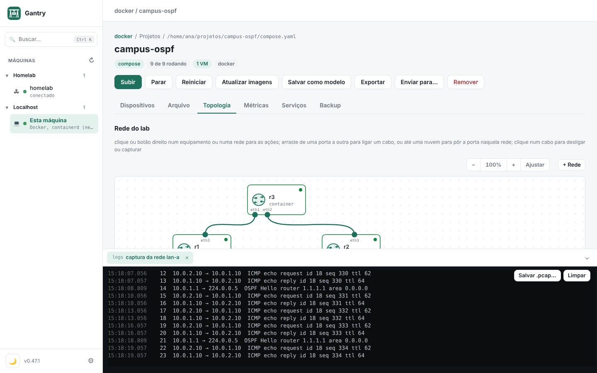

Capturar uma rede inteira grava todas as portas nela. A captura roda na máquina do lab (esta ou o servidor) e nada precisa ser instalado nos equipamentos.

## 11. Estados do lab: guardar o exercício e voltar

**Dispositivos** › **Estados do lab** › **Salvar estado…** guarda de uma vez a configuração de todos os equipamentos de rede e VMs: a NVRAM do IOL e do Dynamips, a configuração do VPCS e um snapshot de cada VM. **Restaurar** volta todos para aquele ponto. **Recomeçar do zero…** apaga o que o IOL e o Dynamips salvaram, para eles iniciarem limpos; os estados salvos continuam na lista. Containers (como os roteadores FRR daqui) não entram no estado: a configuração deles está nos arquivos do projeto.

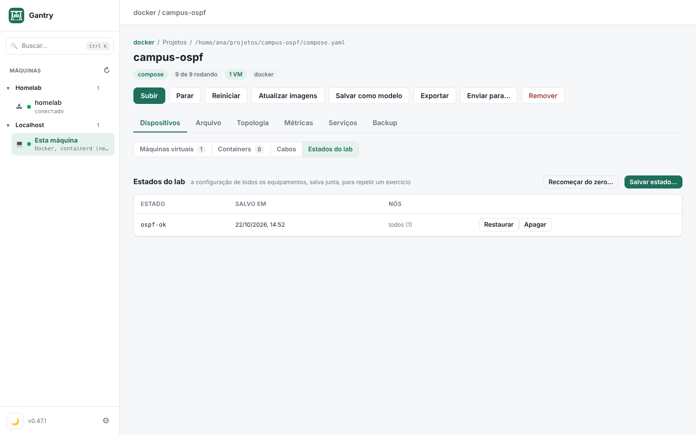

Use como um ponto de salvamento do exercício: salve antes de tentar algo arriscado, restaure quando der errado. A configuração inicial de um equipamento (`config:`) só vale no primeiro boot; depois, vale o que o equipamento salvou (`write memory`).

## 12. Caso: importar um lab do PNETLab ou do EVE-NG

O professor mandou um lab `.unl`. Projetos › **Outras formas** › **Importar do PNETLab/EVE-NG**, escolha o arquivo e a pasta de destino (num servidor, o seletor lista as pastas do servidor e cria pastas novas). Ou na linha de comando:

```sh
gantry importar-unl LAB.unl PASTA
```

A importação é fiel: mesmos equipamentos, placas, NPE, cabos e configurações salvas, inclusive os erros postos de propósito. A pasta recebe:

- `compose.yaml`, pronto para subir;
- `equipamentos/`, a configuração de cada equipamento;
- `original/`, o `.unl` original;
- `IMPORTACAO.md`, com o que precisou mudar (por exemplo, um 7200 com mais de 256 MB vira 256 MB, porque o Dynamips não inicia com mais) e os pontos de atenção no original (um switch rodando imagem de roteador, uma interface que o equipamento não tem).

Um equipamento que o Gantry ainda não roda impede a importação, com uma mensagem clara. Quando o lab precisa de um programa que a máquina não tem (`dynamips`, `python3`, bibliotecas de 32 bits para imagens IOL antigas), a importação diz qual, e a aba **Ferramentas** dá o comando de instalação.

Depois do primeiro início, a lista de VMs do lab mostra **N linhas recusadas** ao lado de um equipamento cuja configuração salva tinha linhas que o IOS não aceitou, e **sem idle-PC** ao lado de um roteador Dynamips que ainda gasta uma thread inteira do processador: clique para resolver (**Gerenciar › Calcular idle-PC**).

As imagens Cisco não vêm junto: ponha os seus arquivos `.bin` e `.image` na pasta de imagens da máquina (página da máquina › Configuração › Imagens).

## 13. Máquinas virtuais

As VMs vão no mesmo compose, em `x-vms`, e rodam no QEMU da máquina do projeto (HVF no Mac, KVM no Linux):

```yaml
x-vms:
  web:
    image: debian-12          # debian-13, ubuntu-24.04, rocky, uma URL, um .qcow2 ou uma ISO
    cpus: 1
    memory: 1g
    disk: 8G
    ports: ["8081:80"]
    packages: [nginx]
    run:
      - echo ok > /var/www/html/ok.txt
```

Ou use o assistente: Criar projeto › **Máquina virtual**, com modelos (Debian, Ubuntu com Docker, k3s, Rocky, NixOS, LAMP, por ISO) ou um setup próprio (sistema, tamanho, pacotes, script de inicialização com exemplos).

Cada VM tem **Console** (serial, mostra o boot), **Shell** (SSH dentro do app), **Logs** (`journalctl -f`), **Tela** (VNC, para instalar por ISO) e **Gerenciar…**: snapshots (com a memória, voltam sem reiniciar), aumentar o disco, clonar, iniciar junto com a máquina. **Importar disco…** transforma um OVA, VMDK, VDI ou VHD(X) numa VM.

**Caso prático: um cluster k3s.** Criar projeto › Máquina virtual › **Cluster k3s (3 VMs)**. Os agentes esperam o servidor (`depois:`) e, quando a API responde, o cluster aparece na barra lateral, pronto para usar como na próxima seção.

## 14. Backup e restauração

A aba **Backup** copia os volumes do projeto, um dump de cada banco que ele roda (PostgreSQL, MySQL/MariaDB, MongoDB) e a pasta do projeto num `.tar.gz` só, numa pasta deste computador que você escolhe. Vale também para projetos em servidores.

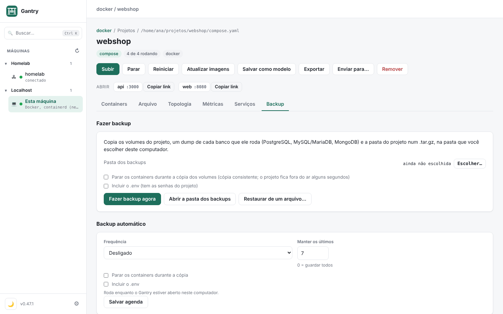

- **Fazer backup agora**, com as opções de parar os containers durante a cópia e de incluir o `.env`.
- **Backup automático**: a cada 6 h, 12 h, dia ou semana, mantendo os últimos N, enquanto o Gantry estiver aberto.
- **Restaurar de um arquivo…** recria os volumes a partir do backup e sobe o projeto de novo.

## 15. Clusters Kubernetes

Engrenagem › **Clusters** › adicione um contexto do `~/.kube/config` ou cole um kubeconfig. Os clusters aparecem na barra lateral, junto das máquinas.

O que você tem, sem `kubectl`: uma visão geral (nós, pods com problema e o motivo, avisos recentes), listas de workloads, rede, configuração e armazenamento com filtro por namespace, detalhes ao lado (containers, probes, montagens, eventos), logs (inclusive da execução anterior de um container que caiu), shell, encaminhar porta, escalar, reiniciar, histórico de versões com voltar, drain, releases do Helm com voltar, CRDs com as colunas delas, editar e aplicar YAML, e o **Diagnóstico**, que diz o que está errado com um pod agora.

Cada cluster pode ficar **Só leitura**: tudo visível menos o valor dos Secrets, sem shell, sem mudanças. O Gantry também pergunta ao cluster o que a sua conta pode fazer e esconde os botões que ela não pode usar.

## 16. Ferramentas: o que falta em cada máquina

A aba **Ferramentas** de cada máquina (esta ou um servidor) lista o que o Gantry usa lá, para que serve cada um e o comando de instalação daquele sistema (Homebrew, apt, dnf, pacman, apk, zypper). No Mac, o que vem do Homebrew instala com um botão.

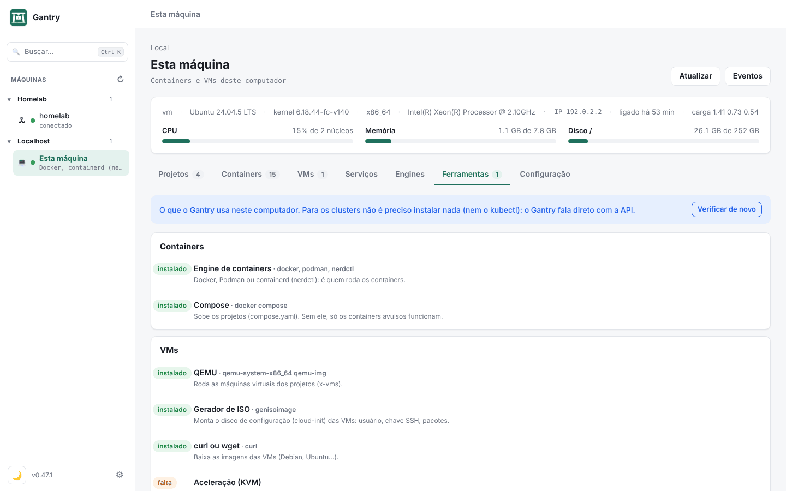

Projetos e o assistente avisam quando falta algo que eles usam (QEMU para as VMs, compose, dynamips para um roteador Dynamips).

## 17. Configuração e assistentes de IA

A engrenagem abre a **Configuração**: **Máquinas**, **Clusters**, **Pastas**, **Credenciais** (logins dos registros de imagens, senhas de SSH desta sessão, onde ficam os segredos) e **Geral** (tema, idioma, versão, diagnóstico).

**Geral › Assistentes (MCP)** deixa um assistente de IA (um assistente desktop, uma IDE, qualquer cliente MCP) consultar o Gantry enquanto ele está aberto: máquinas, projetos, logs de containers, clusters, logs de pods, eventos. Escrever (subir, reiniciar, escalar) é uma permissão à parte. Secrets e values do Helm nunca saem, e clusters só leitura continuam só leitura. O cartão mostra o comando exato para pôr na configuração do cliente (`gantry mcp`).

**Geral › Ver diagnóstico** junta o necessário para reportar um problema (versões, estado das máquinas e clusters, erros internos, fim do log) sem endereços, usuários nem senhas.
