# Gantry guide

**English** · [Português](../guia/README.md) · [Reference](../reference.md) · [Back to the start](../../README.md)

A walk through Gantry with real cases, from the first launch to a network lab with routers. Each part stands on its own: jump to the one you need.

The screenshots come from a demo setup: this computer with Docker, Podman and containerd, a server called `homelab` reached over SSH, a small web project (`webshop`) and an OSPF lab (`campus-ospf`).

**Contents**

1. [First launch](#1-first-launch)
2. [A machine and its projects](#2-a-machine-and-its-projects)
3. [Add a server over SSH](#3-add-a-server-over-ssh)
4. [Create a project from a template](#4-create-a-project-from-a-template)
5. [Bring an existing compose or `docker run` into Gantry](#5-bring-an-existing-compose-or-docker-run-into-gantry)
6. [Edit the compose and apply the change](#6-edit-the-compose-and-apply-the-change)
7. [Containers: logs, shell, files](#7-containers-logs-shell-files)
8. [Metrics](#8-metrics)
9. [Case: an OSPF lab with routers, a PC and a server](#9-case-an-ospf-lab-with-routers-a-pc-and-a-server)
10. [Capture traffic on a cable](#10-capture-traffic-on-a-cable)
11. [Lab states: save the exercise and go back](#11-lab-states-save-the-exercise-and-go-back)
12. [Case: import a PNETLab or EVE-NG lab](#12-case-import-a-pnetlab-or-eve-ng-lab)
13. [Virtual machines](#13-virtual-machines)
14. [Backup and restore](#14-backup-and-restore)
15. [Kubernetes clusters](#15-kubernetes-clusters)
16. [Tools: what each machine is missing](#16-tools-what-each-machine-is-missing)
17. [Settings and AI assistants](#17-settings-and-ai-assistants)

## 1. First launch

Install Gantry (see [Download](../../README.md#download)) and open it. With no servers or clusters of yours yet, the welcome screen shows:

- what Gantry found on this computer (Docker, Podman, containerd, QEMU) and what is missing;
- the servers in your `~/.ssh/config`, one click each to add;
- the clusters in your `~/.kube/config`, the same way;
- a first project: a test Postgres + Adminer with the password already created.

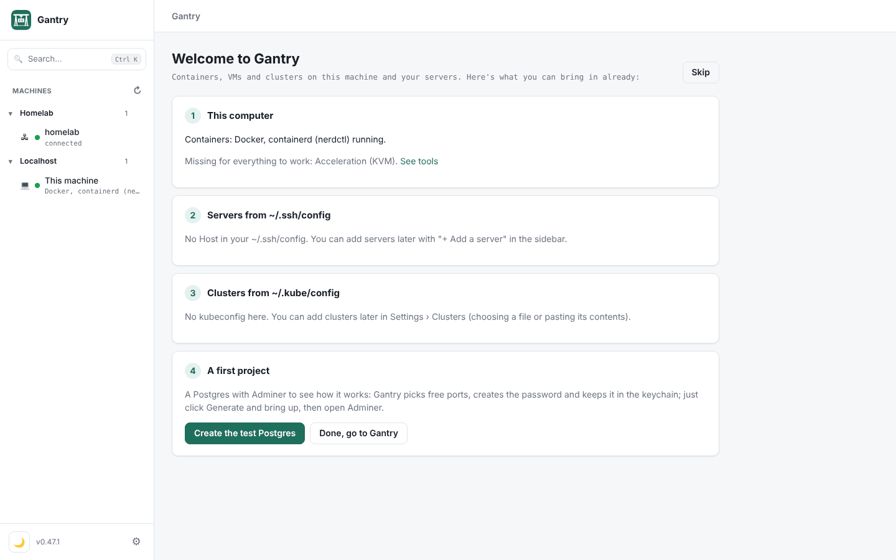

**Skip** goes straight to the app. The welcome screen comes back in gear › **General** › Open the welcome screen.

## 2. A machine and its projects

The sidebar lists machines, not containers. **This machine** joins every engine of this computer (Docker, Podman, containerd) in one entry. Folders (here, *Homelab* and *Localhost*) group machines; a folder shows how many machines it has and how many have a problem, even when closed.

The machine page shows the hardware and the CPU, memory and disk usage, and then the tabs: **Projects**, **Containers**, **VMs**, **Services**, **Engines**, **Tools** and **Settings**.

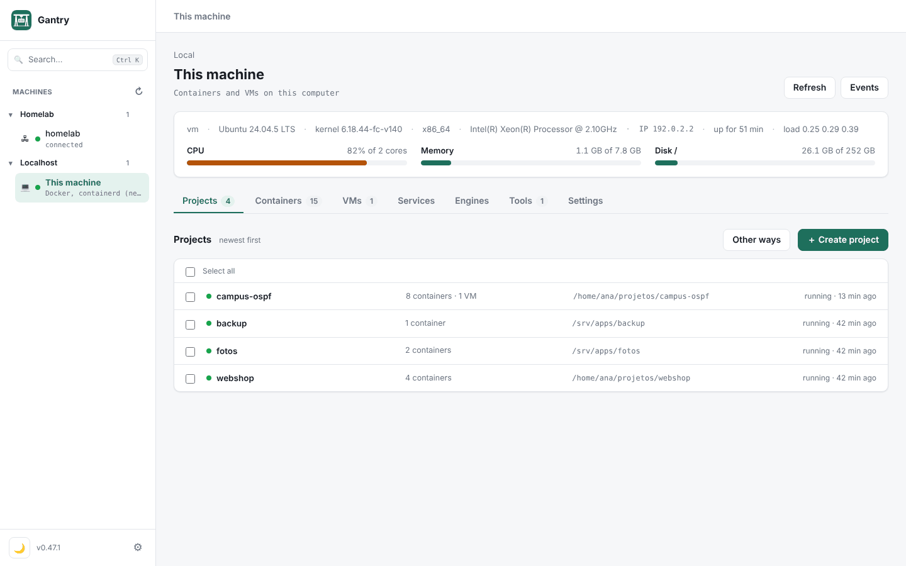

Every compose project on the machine is listed, whether Gantry created it or you ran `docker compose up` in a terminal: Gantry reads the labels Compose writes. Containers outside any compose appear as loose.

Tip: **Ctrl K** (⌘K on a Mac) opens a search across machines, projects, containers and screens.

## 3. Add a server over SSH

Gantry reaches servers with your own SSH: keys, `~/.ssh/config` aliases, jump hosts. Nothing is installed on the server.

1. Gear › **Machines** › **+ Add machine**.
2. Address: `ssh://homelab` (an alias from `~/.ssh/config`) or `ssh://ana@192.0.2.10:22`.
3. Choose a folder for it in the sidebar (optional).

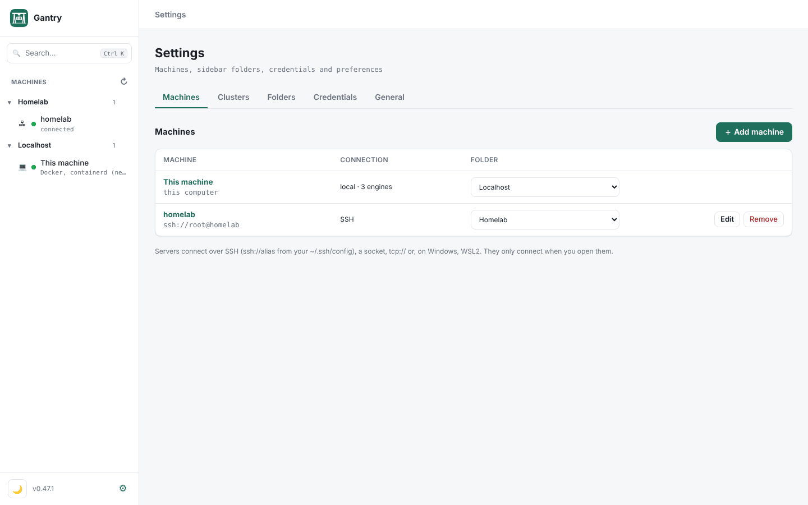

The server connects only when you open it. Passwords and key passphrases are asked in the app. Gantry looks for the Docker or Podman socket on the server and forwards it through the SSH connection; for rootless Podman it offers a button to turn on the user's `podman.socket`.

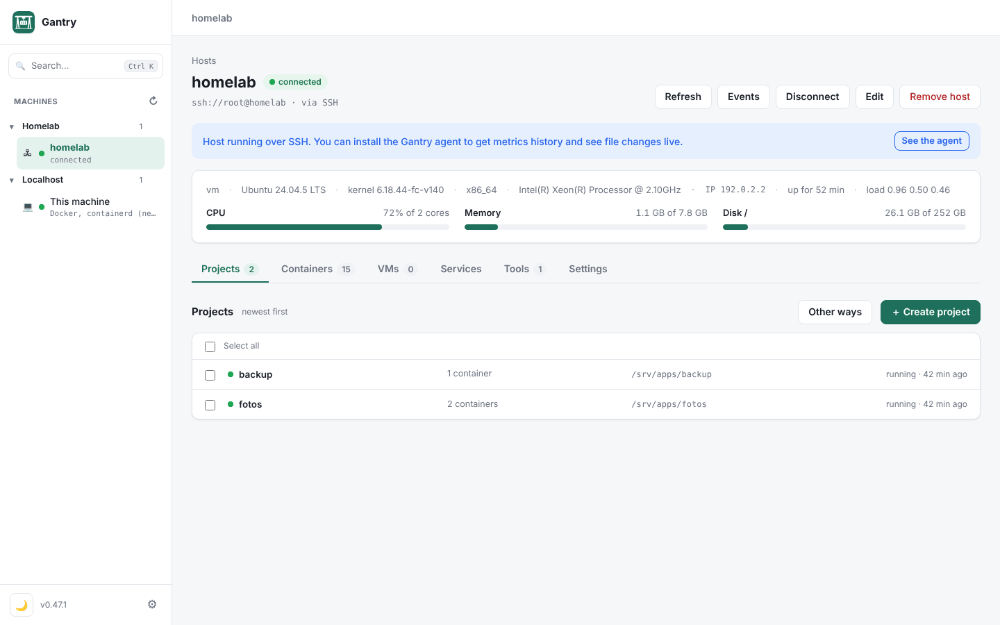

The blue strip offers the optional agent: with it, the server keeps 24 h of metrics even with the app closed, and the app talks to it over a direct TLS connection. Without it, everything still works over SSH.

## 4. Create a project from a template

**Create project** opens a three-step wizard.

**Step 1, Type:** containers, a virtual machine, or both.

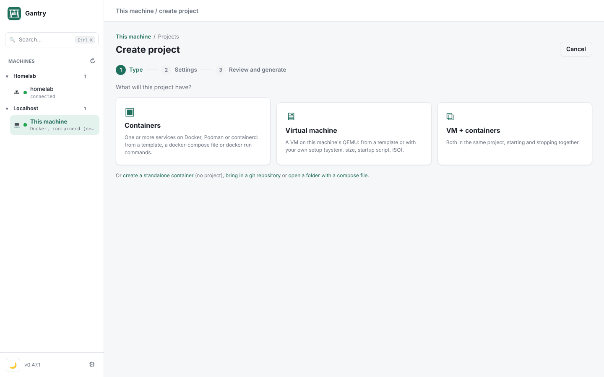

**Step 2, Settings:** the engine (Docker, Podman, containerd) and the source:

- **Template**: 30+ ready projects with fixed image versions: databases (Postgres, MySQL, MariaDB, MongoDB, Redis), queues (RabbitMQ, Kafka), monitoring (Prometheus + Grafana, Uptime Kuma), identity (Keycloak, Vault), dev tools (Gitea, n8n, Mailpit, VS Code in the browser, Jupyter), AI (Ollama + Open WebUI) and network labs.
- **Paste docker-compose**: a compose you already have.
- **docker/podman/nerdctl command**: one or more `docker run` lines, converted to compose.

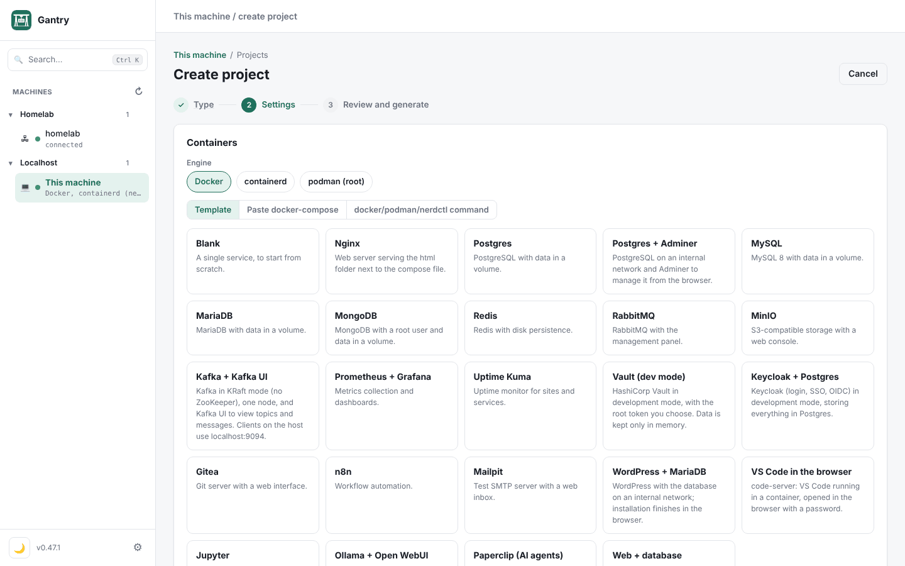

**Step 3, Review and generate:** the YAML, editable, with a summary on the side. Template variables become fields: passwords are generated and can go to the system keychain instead of `.env`. Port variables already in use on the machine get the next free port, with the reason under the field. Choose the name, the folder and the target machine (this one or a server), then **Generate project**.

**Practical case: a Postgres for a side project.** Create project › Containers › **Postgres + Adminer** › **Generate project**. Gantry writes `compose.yaml` and `.env` to the project folder, keeps the password in the keychain and brings it up. The project page shows an **Open** strip with Adminer's link. Later, in another project, the **Services** tab offers **Use in this project…**: Gantry creates a database and a user just for that project in the same Postgres and writes the connection to its `.env`.

## 5. Bring an existing compose or `docker run` into Gantry

You do not need to recreate anything:

- **Already running?** It is already listed. Open it to see its containers; the File tab shows the compose Gantry found through the Compose labels.
- **A folder with a compose that is not running:** Projects › **Other ways** › open a folder with compose. Gantry brings it up.
- **A git repository:** Other ways › project from a git repository. The File tab later shows how many new commits the remote has.
- **A `docker run` from a README:** Create project › Containers › docker/podman/nerdctl command. Ports, volumes, variables, network, limits, restart policy and healthcheck become compose; whatever has no equivalent becomes a warning, so nothing disappears silently.
- **A package from another Gantry:** Other ways › import package (a `.tar.gz` made with **Export**).

## 6. Edit the compose and apply the change

The project page has the actions on top (**Bring up**, **Stop**, **Restart**, **Pull images**, **Save as template**, **Export**, **Send to…**, **Remove**), the **Open** strip with the web ports, and the tabs.

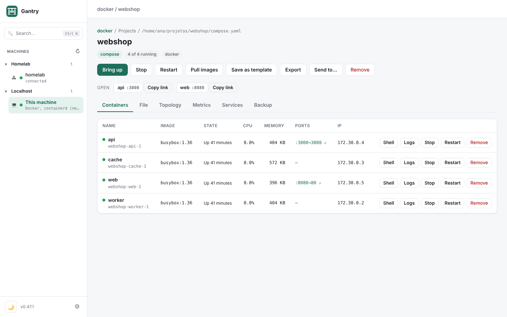

The **File** tab edits the `compose.yaml`, the `.env` and the other text files in the folder. The panel on the right compares each service with what is running.

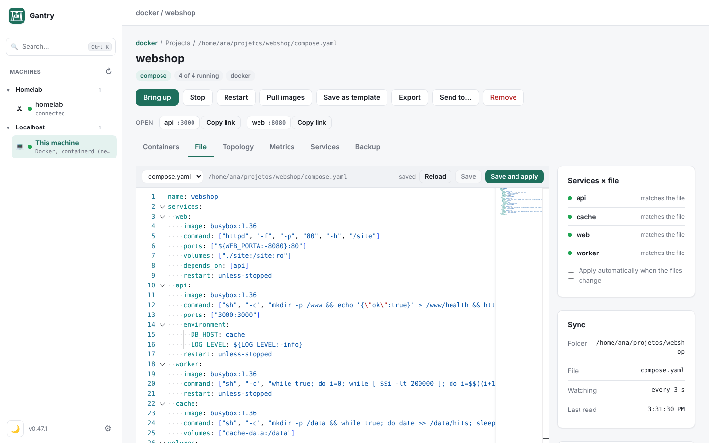

- **Save and apply** writes the file and runs `compose up` for what changed.
- Edit in your own editor if you prefer (Nvim, VS Code): the file is reread every 3 s, and the page says **The project files changed**, with what changes in each service and the **Apply now** button. If you edit in both places at once, the app warns about the conflict.
- **Apply automatically** (off by default) applies when the files stop changing for a few seconds. A file with an error is never applied.

**Practical case: change a port.** In `.env`, change `WEB_PORTA=8080` to `8081`, **Save and apply**. Only `web` is recreated; the **Open** strip shows the new port.

## 7. Containers: logs, shell, files

Each container row has **Shell**, **Logs**, **Stop**, **Restart** and **Remove**. Clicking the name opens the container page.

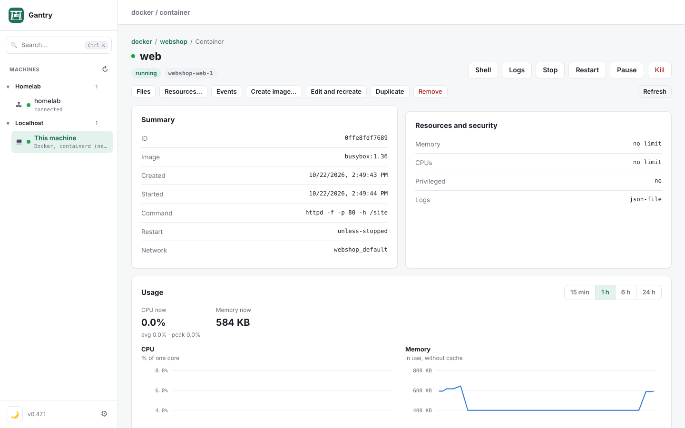

- **Logs**: live, with a line filter, a time range (15 min to 24 h, or all), timestamps and **Save…** to a file.
- **Shell**: an interactive terminal inside the app.
- **Files**: browse the container's folders, download (folders come as `.tar`), upload from this computer, delete. Works with the container stopped, too.
- **Resources…**: change CPU, memory and restart policy without recreating.
- **Edit and recreate** and **Duplicate**: the full form, filled in with the current options. The old container is kept aside until the new one is up; if something fails, it comes back.
- **Events**: created, started, exited with code, out of memory, in the last 1 h, 24 h or 7 days.
- **Create image…**: `docker commit` of the current state.

Logs, shells and consoles open as tabs in the bottom panel. Drag a tab sideways to reorder it, or up, out of the panel, to turn it into a window you move and resize from its corner; the terminal keeps its session. To put it back, drop the window on the panel's bar, double-click its title or use ⤓. Right-click in a terminal to copy and paste (also Ctrl+Shift+C and Ctrl+Shift+V).

## 8. Metrics

The **Metrics** tab of a project charts CPU and memory per container and per VM, from 15 minutes to 24 hours, with a summary table. Click a name in the legend or in the table to highlight it.

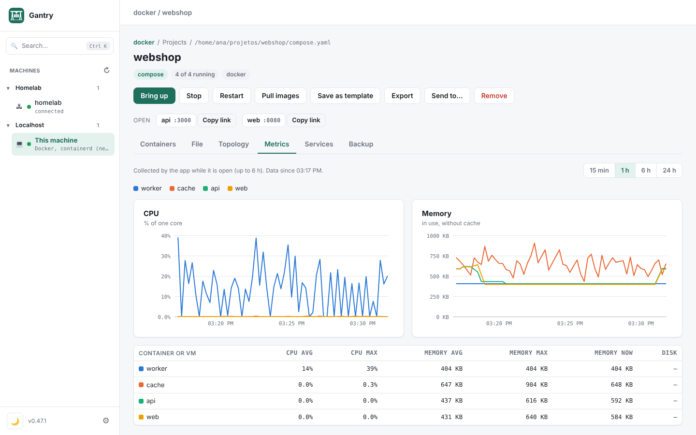

Without the agent, the app collects while it is open (up to 6 h). With the agent on a server, the history stays there even with the app closed. If there is a Prometheus near the machine, the tab also offers it as a source, with a PromQL field.

## 9. Case: an OSPF lab with routers, a PC and a server

A network lab is a compose like any other. This one has three FRR routers in containers, wired in a triangle, two LANs, a VPCS computer on LAN A and a web server on LAN B:

```yaml
name: campus-ospf
x-frr: &frr
  image: frrouting/frr:8.4.4
  command: ["sh", "/frr.sh"]          # starts zebra and ospfd, area 0 on every interface
  volumes: ["./frr.sh:/frr.sh:ro"]
  cap_add: [NET_ADMIN, NET_RAW, SYS_ADMIN]
  sysctls: {net.ipv4.ip_forward: 1}
  x-icon: router
x-redes:                               # lab networks: one switch each
  lan-a: {subnet: 10.0.1.0/24, gateway: 10.0.1.1}
  lan-b: {subnet: 10.0.2.0/24, gateway: 10.0.2.1}
services:
  r1:
    <<: *frr
    environment: {RID: 1.1.1.1}
    x-interfaces: [{rede: lan-a, ip: 10.0.1.1/24}, {link: r1-r2, ip: 10.0.12.1/30}, {link: r1-r3, ip: 10.0.13.1/30}]
  r2:
    <<: *frr
    environment: {RID: 2.2.2.2}
    x-interfaces: [{link: r1-r2, ip: 10.0.12.2/30}, {rede: lan-b, ip: 10.0.2.1/24}, {link: r2-r3, ip: 10.0.23.1/30}]
  r3:
    <<: *frr
    environment: {RID: 3.3.3.3}
    x-interfaces: [{link: r1-r3, ip: 10.0.13.2/30}, {link: r2-r3, ip: 10.0.23.2/30}]
  srv-b:
    image: busybox:1.36
    x-interfaces: [{rede: lan-b, ip: 10.0.2.10/24}]
    x-icon: server
x-vms:
  pc1:
    image: vpcs                        # comes with Gantry
    interfaces: [lan-a]
    config: pc1.vpc                    # ip 10.0.1.10 10.0.1.1 24
```

- `x-interfaces` on a service adds ports to the container: `link:` is a point-to-point cable (two ends with the same name are connected), `rede:` plugs the port into a lab network.
- `x-vms` holds the network devices that are not containers: VPCS, Cisco IOL and Dynamips. Their `interfaces:` list the cables in port order.
- The same compose could use Cisco routers instead of FRR: `image: cisco-iol` or `cisco-c7200`. Everything about them (cards, NPE, memory, images) is in [Network equipment](../network-labs.md).

**Bring up**, then the **Topology** tab draws the lab from the compose:

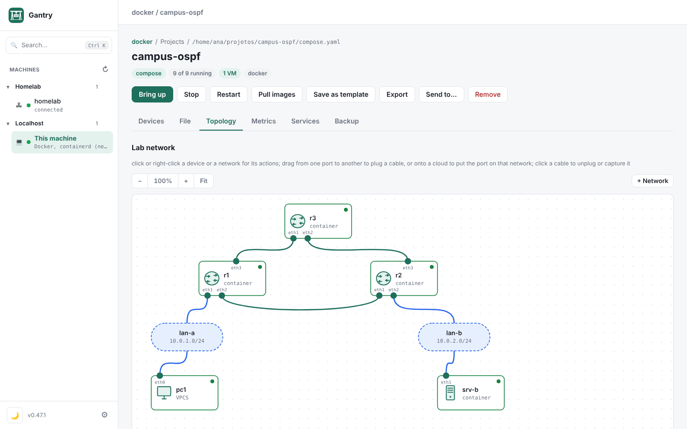

The drawing is also an editor: drag from one port to another to wire a cable, drag a port onto a network cloud to plug it in, and use right-click for the actions: on a cable, unplug or capture; on a device, console, shell, logs, start and stop; on a network, capture and edit. Double-clicking a running device opens its console, as in GNS3. To move around the drawing, drag the background (or hold Space, or the middle button, and drag); Ctrl or ⌘ + wheel zooms in and out at the mouse. Each port leaves from the side of the device that faces its neighbor. Cables can be **Straight**, as in Packet Tracer, or **Curves**. Hovering a device, a network or a cable highlights its cables and fades the others. **Spread out** moves apart devices that touch (common in labs imported from PNETLab) without changing the arrangement. Each cable end has a light, as in Packet Tracer: green when the interface is active, red when nothing comes out of it (on a Cisco router or switch, `shutdown` or still starting) and gray when the device is stopped. On Cisco devices the light follows the port's traffic (keepalive, CDP, spanning tree); VPCS, containers and VMs are green while they run. **+ Network** adds a lab network (a switch, with optional subnet and DHCP). Positions and icons are saved in the compose (`x-pos`, `x-icon`).

The **Devices** tab groups the lab's parts in sub-tabs: **Virtual machines** (here, the VPCS), **Containers**, **Cables** and **Lab states**.

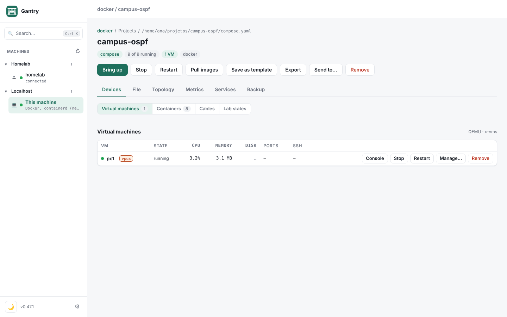

**Cables** lists the ports of each device, where each one is plugged and its address, with the same editing as the drawing.

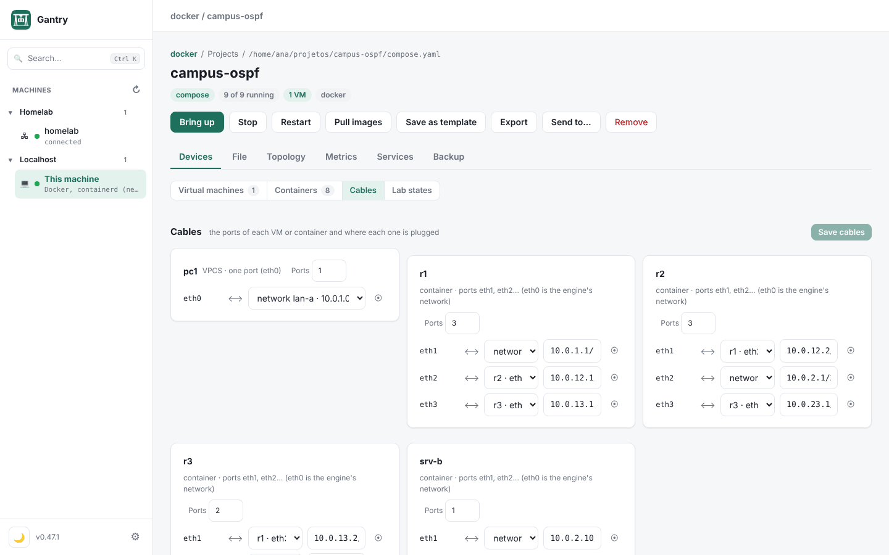

To test: right-click `pc1` › Console, then `ping 10.0.2.10`. The ping crosses r1 and r2 once OSPF has converged (a few seconds); `docker exec campus-ospf-r1-1 vtysh -c "show ip ospf neighbor"` or the r1 shell shows the neighbors.

## 10. Capture traffic on a cable

Click a cable (or right-click a network cloud) › **Watch live here**. The capture opens in the bottom panel, decoded line by line; **Save .pcap…** keeps what was captured so far, to open in Wireshark.

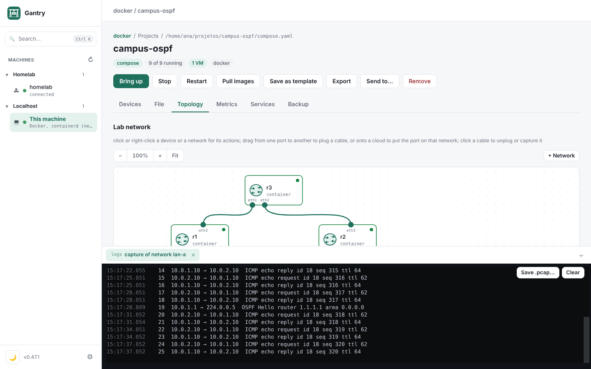

Capturing a whole network records every port on it. The capture runs on the machine of the lab (this one or the server) and nothing needs to be installed in the devices.

## 11. Lab states: save the exercise and go back

**Devices** › **Lab states** › **Save state…** keeps the configuration of every network device and VM at once: the NVRAM of IOL and Dynamips, the VPCS configuration and a snapshot of each VM. **Restore** puts them all back at that point. **Start from scratch…** erases what the IOL and Dynamips devices saved, so they boot clean again; the saved states stay in the list. Containers (like the FRR routers here) are not part of a state: their configuration is in the project files.

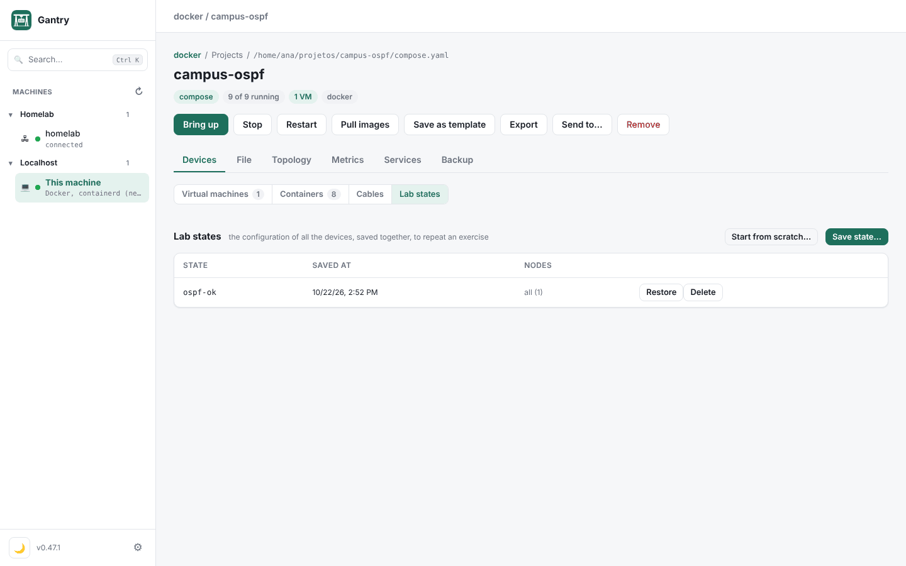

Use it like a save point in an exercise: save before trying something risky, restore when it goes wrong. The startup configuration of a device (`config:`) only applies on its first boot; after that, what the device saved (`write memory`) is what counts.

## 12. Case: import a PNETLab or EVE-NG lab

A teacher sent a `.unl` lab. Projects › **Other ways** › **Import from PNETLab/EVE-NG**, choose the file and the destination folder (on a server, the folder picker lists the server's folders and creates new ones). Or on the command line:

```sh
gantry importar-unl LAB.unl FOLDER
```

The import is faithful: same devices, cards, NPE, cables and saved configurations, including errors put there on purpose. The folder gets:

- `compose.yaml`, ready to bring up;
- `equipamentos/`, the configuration of each device;
- `original/`, the original `.unl`;
- `IMPORTACAO.md` (in Portuguese), with what had to change (for example, a 7200 with more than 256 MB becomes 256 MB, because Dynamips cannot boot it with more) and the points of attention in the original (a switch running a router image, an interface the device does not have).

A device Gantry does not run yet stops the import with a clear message. When the lab needs a program the machine does not have (`dynamips`, `python3`, 32-bit libraries for old IOL images), the import says which one and the **Tools** tab gives the install command.

After the first start, the lab's VM list shows **N lines refused** next to a device whose saved configuration had lines IOS did not accept, and **no idle-PC** next to a Dynamips router still spinning a whole CPU thread: click to fix (**Manage › Compute idle-PC**).

Cisco images are not included: put your `.bin` and `.image` files in the machine's image folder (machine page › Settings › Images).

## 13. Virtual machines

VMs go in the same compose, under `x-vms`, and run in QEMU on the project's machine (HVF on a Mac, KVM on Linux):

```yaml
x-vms:
  web:
    image: debian-12          # debian-13, ubuntu-24.04, rocky, a URL, a .qcow2 or an ISO
    cpus: 1
    memory: 1g
    disk: 8G
    ports: ["8081:80"]
    packages: [nginx]
    run:
      - echo ok > /var/www/html/ok.txt
```

Or use the wizard: Create project › **Virtual machine**, with templates (Debian, Ubuntu with Docker, k3s, Rocky, NixOS, LAMP, from ISO) or your own setup (system, size, packages, startup script with examples).

Each VM has **Console** (serial, shows the boot), **Shell** (SSH inside the app), **Logs** (`journalctl -f`), **Screen** (VNC, for ISO installs) and **Manage…**: snapshots (with memory, resume without rebooting), grow the disk, clone, start with the machine. **Import disk…** turns an OVA, VMDK, VDI or VHD(X) into a VM.

**Practical case: a k3s cluster.** Create project › Virtual machine › **k3s cluster (3 VMs)**. The agents wait for the server (`depois:`), and when the API answers, the cluster appears in the sidebar, ready to use as in the next section.

## 14. Backup and restore

The **Backup** tab copies the project's volumes, a dump of each database it runs (PostgreSQL, MySQL/MariaDB, MongoDB) and the project folder into one `.tar.gz`, in a folder of this computer you choose. It works for projects on servers too.

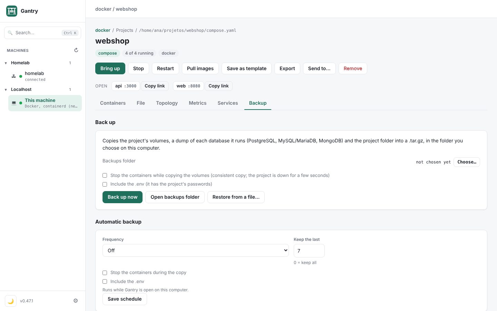

- **Back up now**, with options to stop the containers during the copy and to include `.env`.
- **Automatic backup**: every 6 h, 12 h, day or week, keeping the last N, while Gantry is open.
- **Restore from a file…** recreates the volumes from the backup and brings the project up again.

## 15. Kubernetes clusters

Gear › **Clusters** › add a context from `~/.kube/config` or paste a kubeconfig. Clusters appear in the sidebar next to the machines.

What you get, without `kubectl`: an overview (nodes, failing pods and why, recent warnings), workloads, network, config and storage lists with a namespace filter, details on the side (containers, probes, mounts, events), logs (also of the previous run of a crashed container), shell, port forward, scale, restart, revision history with roll back, drain, Helm releases with roll back, CRDs with their own columns, YAML edit and apply, and **Diagnostics** that tells what is wrong with a pod now.

Each cluster can be **Read-only**: everything visible except Secret values, no shell, no changes. Gantry also asks the cluster what your account can do and hides the buttons it cannot use.

## 16. Tools: what each machine is missing

The **Tools** tab of each machine (this one or a server) lists what Gantry uses there, what each is for, and the install command for that system (Homebrew, apt, dnf, pacman, apk, zypper). On a Mac, Homebrew items install with a button.

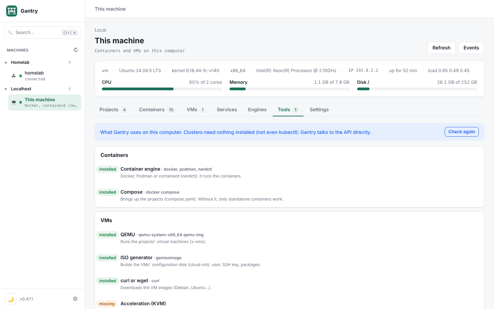

Projects and the wizard warn when something they use is missing (QEMU for VMs, compose, dynamips for a Dynamips router).

## 17. Settings and AI assistants

The gear opens **Settings**: **Machines**, **Clusters**, **Folders**, **Credentials** (image registry logins, SSH passwords of this session, where secrets are kept) and **General** (theme, language, version, diagnostics).

**General › Assistants (MCP)** lets an AI assistant (a desktop assistant, an IDE, any MCP client) query Gantry while it is open: machines, projects, container logs, clusters, pod logs, events. Writing (bring up, restart, scale) is a separate permission. Secrets and Helm values never leave, and read-only clusters stay read-only. The card shows the exact command to put in the client's configuration (`gantry mcp`).

**General › View diagnostics** gathers what is needed to report a problem (versions, state of machines and clusters, internal errors, end of the log) without addresses, users or passwords.
